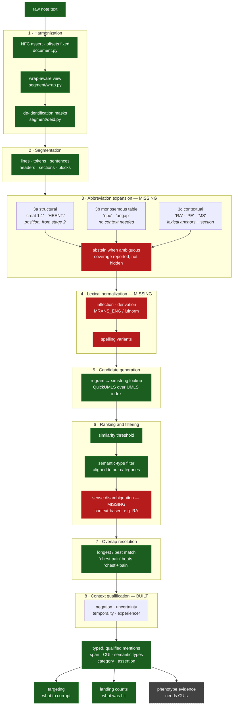

# The concept-matching pipeline

What has to happen between raw note text and a typed, qualified concept mention —
and which stages RobustEHR has, which it borrows, and which are still missing.

Drawn because performance work without a map is guesswork. The measured
weaknesses so far — `procedure` recall at 0.31, and 94% of missed gold spans
being single-word abbreviations — both land on stages that **do not exist yet**,
which is a more useful finding than any parameter would have been.

## The pipeline



Green is built and measured, **red is missing**, dashed grey is planned.

## Stage by stage

| # | Stage | Status | Module | Why it matters here |
|---|---|---|---|---|
| 1 | Harmonization | **built** | `document.py`, `segment/wrap.py`, `segment/deid.py` | Offsets into the original text are the invariant everything else hangs on |
| 2 | Segmentation | **built** | `segment/` | Ours rather than PyRuSH, because masked placeholders defeat its sentence splitting |
| 3 | **Abbreviation expansion** | **missing** | — | 36.8% of all gold spans; 44.9% unreachable in UMLS, half of those structurally anchored |
| 4 | **Lexical normalization** | **missing** | — | `hyperkalemic` is absent where `hyperkalemia` is present |
| 5 | Candidate generation | **built** | `concepts/matcher.py` | QuickUMLS simstring over the local UMLS index |
| 6 | Ranking and filtering | **partial** | `concepts/matcher.py` | Semantic-type filter aligned; **context-based sense disambiguation missing** |
| 7 | Overlap resolution | **built** | `concepts/matcher.py` | `best_match` — `chest pain` wins over its parts |
| 8 | Context qualification | **built** | negated-class F1 **0.9289** (NegEx gold, 2,365 spans; floor 0.0000) | medspaCy ConText, fed our boundaries rather than PyRuSH's — the substitution is measured, not assumed |

## What the missing stages would buy

**Stage 3 — abbreviation expansion.** The diagnosed weak point, and the stage
whose design a measurement changed. Abbreviation-shaped spans are **36.8% of
every gold span in the corpus**, so nothing about this is a corner case.

The V0 gate (`abbreviation_ceiling.json`) established two things before any of it
was built. A perfect disambiguator over UMLS reaches **0.5511** against exact
lookup's **0.4837** — so every disambiguation rung competes for **6.7 percentage
points**. And **44.9% of these spans have no UMLS candidate carrying the right
category at all**: `creat` (131), `rbc` (151), `hgb` (147), `rdw` (137),
`angap` (93). `creatinine` is in UMLS; `creat` is not.

So the problem is **vocabulary, not disambiguation**, and the stage is named
expansion rather than resolution for that reason.

### "Does expansion need context?" has three answers, not two

The question decides the architecture, and the measured placement of these spans
answers it:

| Where it sits | n | unreachable | What disambiguates it | Needs context? |
|---|---:|---:|---|---|
| label of a value — `creat 1.1` | 2,152 | 63.8% | **structural position** | **no** |
| followed by a colon — `HEENT:` | 793 | 71.9% | **structural position** | **no** |
| inside a labelled-value line | 109 | 33.9% | structural position | no |
| free prose | 5,466 | 33.8% | sense inventory, then anchors | **sometimes** |

**Half the unreachable spans (1,943 of 3,825) are structurally anchored.** A
token in the label slot of `creat 1.1` is a lab analyte because of *where it is*,
not because of what surrounds it semantically — and stage 2 already computed that
position. This is a third answer that "context vs no context" hides, and it is
the largest single class.

The stage therefore splits three ways:

| Sub-stage | Handles | Evidence used | Runs |
|---|---|---|---|
| **3a structural expansion** | `creat 1.1`, `HEENT:` | position, from stage 2 | before stage 5 |
| **3b monosemous expansion** | `npo`, `angap` in prose | none — one clinical sense | before stage 5 |
| **3c contextual disambiguation** | `RA`, `PE`, `MS` | lexical anchors + section | before stage 5, **abstains by default** |

**What makes context-free expansion safe is the table's entry criterion, not an
assumption that context does not matter.** A short form enters 3b **only if it is
monosemous in clinical text**. `RA` never enters it — not because expansion is
unsafe in general, but because that particular entry would be. The abstention
discipline lives in how the table is *built*, which is also where a clinician
review can see it.

**3c runs at stage 3, not later, and its evidence must be lexical.** This is a
real constraint rather than a preference: disambiguating `RA` from the *concepts*
around it would require stage 5's output, which requires stage 3 — a cycle. So
anchors are **surface strings** (`sat`, `O2`, `%` → room air; `joint`,
`methotrexate` → rheumatoid arthritis), available from stage 2, and the cycle
never forms.

### Why not just let a contextualizer resolve the ambiguous ones?

The obvious objection, and the answer is that we do — but it handles a different
population from the table, and the two are told apart by **candidate-set size**
rather than by how hard they look.

Measured, exact match against UMLS with QuickUMLS's own semantic types:

| Surface | UMLS concepts | Problem | Instrument |
|---|---:|---|---|
| `creat`, `angap`, `urean`, `rdwsd`, `neuts` | **0** | vocabulary | **expansion table** |
| `ra` | 5 | disambiguation | **anchor vote (3c)** |
| `pt` | 9 | disambiguation | anchor vote — *unless the slot settles it* |
| `ca` | 5 | disambiguation | anchor vote — *unless the slot settles it* |
| `hgb` | 1 | neither | resolves already |

**A contextualizer cannot disambiguate an empty set.** Context chooses among
candidates; it cannot invent one. `creat` returns zero concepts at any threshold
and any semantic-type filter, so no amount of surrounding evidence identifies it
— that is the whole V0 finding, and it is why the table exists at all. The table
is not an alternative to contextual resolution; it is what runs where contextual
resolution has nothing to work with.

Where the candidate set is genuinely ambiguous — `RA` with five concepts — the
objection is exactly right, and stage 3c is that answer.

**And there is a third mechanism, cheaper than either.** `pt` has nine UMLS
concepts and is hopeless in prose, but in the label half of a numeric value it
can only be prothrombin time, because the layout has already established that
the token names a measured quantity. So `pt` appears in the expansion table
**scoped to `value_label` and nowhere else**. That is not bypassing
disambiguation — the structure *is* the disambiguating evidence, and it is
deterministic and free, where a contextualizer is neither.

Hence the entry criterion is *monosemous **within its slot***. It admits `pt`
and `ca`, which a global table would have to refuse, and it still refuses `RA`,
which is ambiguous even inside a slot.

One measured caution against leaning harder on contextual priors than this:
raising the Vanderbilt sense-prior's confidence threshold past τ=0.80 *reduces*
accuracy, and cross-corpus disagreement concentrates exactly where the source
corpus is most confident. A prior's own confidence is not a usable abstention
signal here.

*Locally defined* abbreviations (`shortness of breath (SOB)`) are a fourth and
much smaller case, recoverable from the note itself by a Schwartz–Hearst
extractor — scispaCy ships one, and wiring it changed nothing measurable here,
which is itself the finding: in-text definitions are rare when the shorthand is
institutional.

### Stage 4 is empty, and that is a decision rather than a gap

The stage exists in the map because the problem is real: a note writes
`hyperkalemic` where the terminology holds `hyperkalemia`, and `creatnine` where
it holds `creatinine`. **No component was built for either, and the reason is
measured twice.**

| Framing | Instrument | Result | Verdict |
|---|---|---|---|
| derivational | `MRXNS_ENG`, NLM's own normalized index | ceiling 11.8% of the miss set, precision 17.6% | not warranted |
| spelling | edit-distance correction over English + clinical | recovery 53.0%, accuracy 54.8% | not warranted |

The second is the sharper refusal: a corrector that is right 55% of the time when
it answers introduces about one wrong word for every one it fixes, and a
normalization step that degrades its own input is worse than no step.

**So what actually handles lexical variation is stage 5.** QuickUMLS matches
approximately — Jaccard over character 3-grams at threshold 0.7 — and that
tolerance *is* the normalization, applied at lookup rather than as a rewrite.
Stage 4 is therefore best read as **subsumed**, not missing.

That has a consequence worth stating, because it is the honest cost of the
decision: the tolerance is **asymmetric**. An insertion adds n-grams and survives
(`hypertensionn` matches at 0.909); a deletion or transposition destroys three at
once and matches nothing (`hypertenion`, `pneumonai`, `creatnine`). A
normalization stage would have evened that out. Not having one means the
pipeline is measurably more robust to some character perturbations than others,
and `typo_sensitivity.json` is where that is quantified rather than assumed.

**Stage 4 — what a normalization stage would address.** Single-word concept
lookup under-covers derivation, so `hyperkalemia` is present while
`hyperkalemic`, `euvolemic` and `dysarthric` are not. NLM's `MRXNS_ENG` is the
normalized index built for exactly this and is in every installed release; the
stage is gated rather than built, for the reasons measured below.

**Stage 6 — sense disambiguation.** The one the taxonomy argument turns on. `RA`
is *room air* far more often than *rheumatoid arthritis* in discharge summaries,
and a matcher without context cannot tell. This is where abstention belongs too:
refusing to resolve is better than resolving wrongly, and the refusal rate is
reportable.

## Three levels: span, category, concept

The distinction the whole evaluation turns on, and it belongs here rather than
buried in a measurements file. Take `"...admitted with atrial fibrillation..."`:

| Level | Question | Output | Candidates to choose among | Our score |
|---|---|---|---|---|
| **span** | *where* is a mention? | character offsets | — (a segmentation decision) | **0.431** IoU |
| **category** | *what kind* of thing is it? | `disease` | **11** | **0.606** recall |
| **concept** | *which* thing is it? | SNOMED 49436004 | **3,100,000** | **0.175** IoU |
| **set membership** | is it in *this* phenotype? | hypertension evidence | **~200** | **0.698** recall |

The counterintuitive part is that **category is easier than concept even though
it sits downstream of it**. Category is derived from the matched concept's
semantic types, so a concept error should propagate — but mostly it does not,
because the wrong concept is usually the *right kind* of thing. Picking the wrong
`warfarin` concept still yields T121 and still lands in `medication`. That
asymmetry is why category recall (0.606) is three and a half times the concept
score (0.173) despite depending on it.

Stated as error propagation:

```
span wrong        →  category wrong AND concept wrong      (unrecoverable)
span right, concept wrong, type right  →  category RIGHT   (recovered)
span right, concept wrong, type wrong  →  category wrong   (propagates)
```

Only the third row hurts a category-level consumer, and it is the minority case.

They fail independently, and the failure rates differ sharply. Measured on 12 test notes, 6,841 predictions:

| Outcome | Share |
|---|---|
| lands on a gold span **and** names the right concept | 14.9% |
| lands on a gold span, **wrong concept** | 30.5% |
| lands on no gold span | 54.6% |

**Of the predictions that found the right text, 67% named the wrong concept.**
That single number explains the whole span-to-concept collapse — span IoU
falling to roughly a third of itself — and locates the problem in
*disambiguation*, not detection. (The error classification is a property of
the matcher's candidate set; the proportions do not move with the overlap
policy tuned below.)
Choosing among 3.1 million candidates that share surface forms, without training
data, is the hard part.

### What each downstream capability actually needs

The reason to keep the three levels apart: **most of what RobustEHR does never
needs the level it is weakest at.**

| Downstream capability | span | category | concept | Gated by |
|---|---|---|---|---|
| corrupt everything (agnostic) | — | — | — | nothing |
| corrupt structure (headers, de-id, layout) | — | — | — | segmentation only |
| corrupt only function words / general English | — | — | — | the lexical axis |
| **"corrupt all medications"** | ✓ | ✓ | — | **category, 0.606** |
| **"corrupt diagnoses but not symptoms"** | ✓ | ✓ | — | **category, 0.606** |
| landing counts — what did the edit hit? | ✓ | ✓ | — | category |
| baseline profiling (unrecognized rate) | ✓ | partial | — | span |
| **"corrupt hypertension evidence"** | ✓ | insufficient | ✓ | **set membership** |
| protect a phenotype's evidence from every operator | ✓ | insufficient | ✓ | set membership |
| assertion-aware corruption (negation flips) | ✓ | ✓ | helps | assertion layer |

Two readings matter.

**The phenotype-agnostic half of the taxonomy is already served.** Every RENDER,
INPUT and DISCOURSE operator, and every category-scoped target, needs span plus
category and nothing more — which is the level we measure best and beat both
peer tools at.

**The phenotype-based half needs concept identity, but not concept *linking*.**
Category is genuinely insufficient there: `disease` selects pneumonia and
diabetes alongside hypertension, and hypertension evidence also spans
`medication` and numeric blood-pressure values that carry no category at all. But
the requirement is *set membership* against a declared list, not choosing among
3.1 million — a different and far more tractable problem. See
[targeting-design.md](targeting-design.md).

So the weak number bounds one capability, not the framework.

## Evaluation follows the pipeline

Reporting only the end-to-end number hides which stage failed, and the numbers
above are the argument: an end-to-end score of 0.175 looks like a broken system
until the decomposition shows detection at 0.431 and localizes the loss.

So every stage that can be measured is measured, and the manuscript reports the
ladder rather than a single figure:

**This table is the same ladder as `validation/protocol.md` §0**, at a different
level of detail — that one carries the baseline each stage is compared against,
this one carries the metric. Where they disagree, that document is the source of
truth for stage numbering and status vocabulary.

| # | Stage | Metric | Benchmark | Split | Result |
|---|---|---|---|---|---|
| 1 | harmonization | offset round-trip, byte identity | golden fixtures | — | **verified** |
| 2 | segmentation | boundary agreement + disagreement taxonomy | PyRuSH, 200 MIMIC notes | dev | **0.389 Jaccard** |
| 3a | structural expansion | `procedure` recall / precision | SNOMED challenge | test (68) | **0.415 / 0.382** |
| 3b | monosemous expansion | `procedure` / `lab_measurement` recall | SNOMED challenge | test (68) | **0.502 / 0.490** |
| 3c | contextual disambiguation | accuracy at coverage | SNOMED challenge, 7 forms | test (68) | **0.977 @ 0.229** |
| 4 | lexical normalization | ceiling gain; correction recovery | `MRXNS_ENG`; 5,372 corrupted words | test (68) | **empty — subsumed into stage 5** |
| 5 | candidate generation | character IoU | SNOMED challenge | test (68) | *not scored in isolation* |
| 6 | ranking and filtering | per-category recall | SNOMED challenge | test (68) | **0.638** |
| 6 | ranking and filtering | per-category precision | SNOMED challenge | test (12) | **0.480** |
| 7 | overlap resolution | character IoU, spans / concepts | SNOMED challenge | test (68) | **0.4543 / 0.1762** |
| 8 | context qualification | negated-class F1 | NegEx test set | **0.9289** | measured (negation only; four attributes disclosed-unvalidated) |
| 9 | phenotype set membership | span recall / set recall | SNOMED challenge, 8 phenotypes | test (68) | **0.912 / 0.698** |

Three things this table is careful about:

**Recall and precision come from different splits.** Category recall is measured
over the 68-note test split by `benchmark_sweep.py`; precision comes from
`head_to_head.py` over 12 notes, because precision is only interpretable next to
the two comparator systems. The two are never spliced into one cell.

**Concept IoU belongs to stage 7, not stage 6.** The evidence is in the overlap
table below: `overlapping_criteria` moves it 0.1561 → 0.1750. Crediting that to
ranking would attribute a measured effect to the wrong component.

**Row 9 rests on the stages beneath it.** Stage 3 is built, stage 4 is gated and
deliberately empty, stage 8 is built and validated, and re-running reproduces
every phenotype to four decimal places. `heart_failure` at 0.449 is not a
stage-3 gap: that stage expands *slot-scoped* short forms and `HFrEF` in these
notes is prose, which is what the surface warrant of the phenotype target
(`docs/targeting-design.md`) reaches.

Every row carries the same three comparators where they apply — RobustEHR,
medspaCy, scispaCy — so a stage improvement is always visible relative to the
tools it is built on.

The last row is the one that changed the reading of this table. Set membership
over a declared phenotype scores **0.698** where open-vocabulary concept
assignment scores **0.175**, on the same notes and the same annotations. The two
are not competing measurements of one capability; they are measurements of two
different problems, and the phenotype layer only ever needed the easier one.

### What the stage-6 numbers cost, and what bought them back

The overlap policy is the lever, and it trades the two failure modes against each
other. Measured on the 68-note test split:

| configuration | challenge IoU | span IoU | category recall |
|---|---:|---:|---:|
| QuickUMLS defaults (`overlapping_criteria='score'`) | 0.1561 | 0.4316 | 0.5947 |
| `length` + affix trim + re-match | 0.1747 | 0.4274 | 0.6047 |
| + SNOMED tie-break | **0.1750** | 0.4312 | **0.6063** |

`length` alone is a regression — it lets a longer *approximate* match displace a
shorter *exact* one (`her chest pain` → C0029537 at 0.857, discarding
`chest pain` → C0008031 at 1.000). Trimming closed-class affixes fixes the span
and re-matching the trimmed text fixes the concept; only with both does
preferring length become a net gain. See
[targeting-design.md](targeting-design.md) for the error classification these
were built against.

## The benchmark for stage 3 already exists

Worth establishing before building, because a component nobody can measure is a
component nobody should trust — and the concern that we might lack a corpus for
this turns out to be unfounded.

**39% of the challenge's gold spans are short single tokens**: 29,273 of 75,491
are one alphabetic token of 2–6 characters. Their frequency ranking is almost
exactly our miss list — `hct` (569), `wbc` (568), `rbc` (550), `hgb` (539),
`rdw` (491), `mchc` (490), `creat` (474), `mch` (408), `na` (407), `cl` (384).

So the SNOMED CT Entity Linking Challenge doubles as an abbreviation benchmark,
and a large one. Three levels of measurement follow:

| Level | What it answers | Data |
|---|---|---|
| **end-to-end** | does resolution improve category recall? | the 29,273 short-token gold spans |
| **head-to-head** | do we beat the tool we build on? | scispaCy's `AbbreviationDetector`, already installed |
| component | is sense disambiguation right? | CASI, if publicly obtainable |

The second is the one that governs. scispaCy ships an `AbbreviationDetector`, so
that is the baseline any resolver here must be measured against — reuse it if it
suffices, and if we depart from it, publish the number showing the departure
earned its place.

## What this says about where to spend effort

Parameter tuning has been worked fairly hard — 21 configurations recorded in
`benchmark_history.json`, with the best lifting the challenge metric 68% and
category recall 5%. The remaining gains are unlikely to come from more of it.

The gaps are **whole stages**, and the two that are missing are precisely where
the measured errors are. That is the argument for building stage 3 next rather
than continuing to tune stage 5.

One caveat worth keeping in view: every stage added between the text and the
matcher is a stage that must itself be deterministic, offset-preserving and
versioned, because a concept mention's span has to remain an offset into the
original note. An abbreviation expander that rewrites text would break that; one
that annotates spans with candidate expansions would not.
