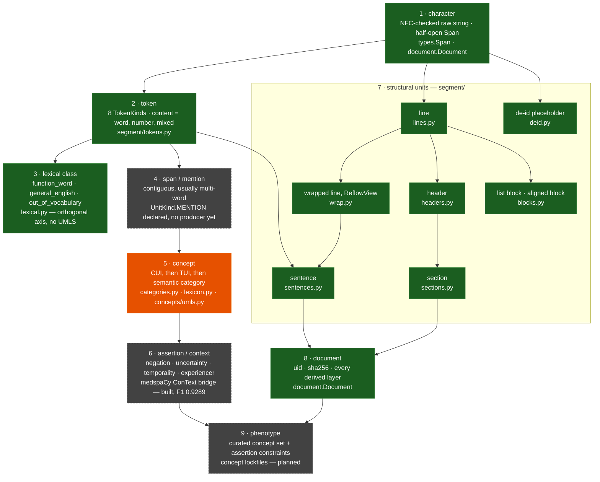

# The hierarchy of NLP units in clinical text

Character, token, span, concept, assertion, phenotype. This document states what
each level is, which RobustEHR module owns it, and — the part that does real work
— **which levels can serve as a dose denominator**.

It exists because "we corrupted 30% of the note" is not a specification. Thirty
percent of *what* determines the experiment: 30% of tokens, 30% of sentences and
30% of medication mentions produce different perturbations, different achieved
character-edit rates, and different downstream claims. Every operator in this
package therefore declares exactly one unit kind in its `DoseSpec`
(`src/robustehr/dose.py`), and the hierarchy below is the set of things that
declaration may name.

Nothing here is a tutorial account of NLP levels. Each section says what is
built, what is reserved, and where the boundary between the two currently falls.

---

## 0. The invariant: offsets into the original text

Every level is a **half-open character range into one immutable string**. That is
the invariant that ties the levels together, and it is stated as the first
governing rule of `src/robustehr/types.py`:

> The raw string is the only text. Every layer is an offset-anchored view into
> it. No layer stores a copy of a substring.

Concretely:

- `Span(start, end)` (`types.py`) is the only positional type. It carries no
  text; the surface is always recovered as `doc.text[span.start:span.end]`.
- `Document` (`src/robustehr/document.py`) holds the text once and builds every
  layer — `LineIndex`, `ReflowView`, `TokenIndex`, `Header`, `Section`,
  `ListBlock`, `AlignedBlock`, `SentenceIndex`, `DeidIndex` — as offset views
  over it. None of them copies a character.
- `Edit` (`types.py`) is an immutable proposal to replace `[start, end)` with a
  replacement string, **against the stage input's offsets**. Operators are pure
  proposers: they never mutate text and never observe each other's output
  (`src/robustehr/ops/base.py`).
- `edits/apply.py` is the only module that produces perturbed text, and it emits
  an `Alignment` (`edits/align.py`) — a monotone piecewise-linear map over the
  unchanged runs — so annotation offsets, evidence spans and protected spans
  survive the perturbation.

Two consequences follow, and both are load-bearing.

**Composition is well defined without any operator knowing about composition.**
A sentence-level deletion and a character-level typo are comparable because both
are `Edit` objects in the same coordinate system, resolved by one canonical total
order (`Edit.sort_key`).

**Cross-level questions are answerable by set arithmetic.** "Did this
character-level typo land inside a medication mention?" is `Span.overlaps`, not a
re-parse. The protection registry (`src/robustehr/protect/registry.py`) and every
target predicate (`src/robustehr/target.py`) are built on exactly this.

The invariant is also why `Document.from_text` **raises** `UnicodeFormError` on
non-NFC input rather than normalizing it. Normalization changes offsets and
character counts; doing it silently would apply an unrecorded perturbation before
any operator ran.

---

## 1. The levels, and who owns each



Green is built and tested, orange is built at word level only, dashed grey is not
yet. The single orange node is the whole story of §5 and §10.

---

## 2. Character

**The unit is a Unicode code point, not a byte and not a grapheme cluster.**
Python string indices are code points, and `Span` indexes the same way. A
combining sequence therefore occupies more than one unit, which is exactly why
NFC is asserted: it gives a rendered string one canonical code-point sequence, so
two producers of the same note agree about where offset 4,182 is.

`src/robustehr/segment/patterns.py` freezes the character classes the whole
segmentation layer is built from — `DIGIT`, `ALPHA`, `HSPACE`, `TERMINATORS`,
`LETTERS`, `UPPERS` — rather than using `\w`, `\d` or `\s`. Those shorthands are
Unicode-database dependent, so two machines on different CPython point releases
can disagree about what matches and therefore about every dose denominator. The
same reasoning produces `ascii_lower()` in `segment/tokens.py` instead of
`str.lower()`.

The module's own docstring states the consequence: these strings are part of the
segmenter's published contract, and changing one is a breaking change to every
previously reported dose, requiring a `SEGMENTER_VERSION` bump. That version is
stamped into every `DoseRecord`.

Character-level `UnitKind` values exist (`CHAR`, `LETTER`, `PUNCT`, `SPACE_RUN`).
Only `SPACE_RUN` is currently consumed, by `render.whitespace_collapse`, whose
denominator is *runs of two or more horizontal whitespace characters*.

## 3. Token

`src/robustehr/segment/tokens.py`. `TokenKind` has eight members:

| Kind | Content? | Example |
|---|---|---|
| `WORD` | yes | `denies`, `HTN` |
| `NUMBER` | yes | `4`, `4.46` |
| `MIXED` | yes | `HCO3`, `T2DM`, `B12` |
| `PLACEHOLDER` | no | a de-identification mask, atomic |
| `DIVIDER` | no | an ASCII horizontal rule |
| `PUNCT` | no | `.` `,` `-` |
| `SPACE` | no | horizontal whitespace run |
| `NEWLINE` | no | one `\n` |

**A content token is `WORD | NUMBER | MIXED`** (`TokenKind.is_content`), and
`TokenIndex.content()` is the tuple that most reported rates are taken over. Note
that this includes numbers: "% of content tokens" in this package's measurements
is over `content()`, not over alphabetic words.

Three tokenizer decisions matter to the hierarchy rather than to tokenization:

- **Whitespace is emitted, not discarded.** `"".join(t.surface(text) for t in
  tokenize(text))` reconstructs the input exactly, which turns "did the layer lose
  anything?" into an assertion. It also gives whitespace operators a real unit to
  count instead of a derived one.
- **De-identification masks are atomic.** Masks are merged into one
  `PLACEHOLDER` token *after* base tokenization, in whatever convention the
  corpus uses. A tokenizer that split `___F` on the word boundary would let
  character operators mangle a fragment and fabricate PHI-shaped text.
- **Decimals are one token.** `4.46` must never become `4` `.` `46`, or
  punctuation deletion turns a lab value into a different number — a
  "preserving" operator producing a factual error.

The third decision propagates upward: sentence splitting works over the token
stream, not over characters, so no boundary rule can see the period inside a
decimal or inside a mask.

`UnitKind.TOKEN` and `UnitKind.WORD` are both consumed. `input.typo` declares
`WORD` with denominator *alphabetic tokens of at least three characters, and
alphanumeric ones of the same length when `include_mixed` is set*;
`input.phonetic_confusion` declares `TOKEN` with denominator *tokens for which a
morpheme rule generates a phonetically confusable substitute*. The two are
deliberately different denominators for what looks like the same level.

## 4. Lexical class — a second, orthogonal axis

`src/robustehr/lexical.py`. Three classes, and **none of them is derived from
UMLS**:

| Class | Source | What it is |
|---|---|---|
| `FUNCTION_WORD` | curated closed-class list in `lexicon.yaml` | determiners, prepositions, conjunctions, auxiliaries, pronouns |
| `GENERAL_ENGLISH` | `general_english.txt`, Zipf ≥ 3.0 from `wordfreq` | ordinary English content words, ~28,000 |
| `OUT_OF_VOCABULARY` | neither list | misspellings, rare technical terms, proper nouns, de-id residue |

`classify_lexical()` checks function words first: a word can be both, and naming
it a determiner is strictly more informative than naming it common. The
closed-class list is verified disjoint from the clinical vocabulary — zero of the
118 entries leak into it.

**This axis is orthogonal to semantic category, and the overlap is the point.**
`home` carries T058 Health Care Activity and therefore appears under `procedure`;
it is also unambiguously general English. So do `take`, `report`, `new` and
`times`. A token that is simultaneously `procedure` and `general_english` is
precisely a token where category membership is least trustworthy, and having both
axes lets a report say so rather than silently counting it as clinical content.

It also makes an honest control condition possible. `Lexical("function_word")`
(`target.py`) selects grammar, which is a much tighter control than
`Uncategorized()` — the latter selects "whatever the terminology missed", which is
a different and weaker thing. `Lexical` is the only content-selective target that
needs **no terminology installed at all**.

Lexical class is a *filter*, not a unit: it has no `UnitKind` and can never be a
denominator on its own. It narrows a token denominator.

## 5. Span / mention — the built/planned boundary

A **span** is any contiguous character range. A **mention** is a span that
realizes a concept in context, and is usually multi-word: `chest pain`,
`no evidence of pneumonia`, `difficulty climbing stairs`.

`UnitKind.MENTION` and `UnitKind.PHRASE` are declared in `types.py`. **No module
produces them.** There is no matcher, no `MentionIndex`, and no operator whose
`DoseSpec` names either. This is the sharpest boundary in the package and it is
worth stating without hedging:

> **Built:** word-level lookup — one token in, a set of UMLS semantic types out.
> **Planned:** span-level concept matching — a contiguous, possibly multi-word
> range in, a resolved concept out.

The architecture already anticipates the swap. `TargetContext.semantic_types()`
in `src/robustehr/target.py` takes a **span**, not a token, and resolves it today
by unioning the semantic types of every overlapping token. Its docstring names
this explicitly as the indirection that lets the matcher change without touching
any target. Every target — `Categories`, `SemanticTypes`, `Uncategorized`, `Not`,
`AllOf`, `AnyOf` — is written against spans, so `Categories("medication")` keeps
working when the resolution behind it becomes concept matching.

The planned implementation is QuickUMLS via `medspacy_quickumls` rather than a
hand-rolled matcher, because its factory already takes an `accepted_semtypes` set
of TUIs — the same axis this package's categories are built on — and because
"we used QuickUMLS with semantic types X and measured P/R/F1 against a gold
standard" is a defensible sentence where "we wrote a dictionary matcher" is not.
One caveat travels with it: QuickUMLS matching is approximate, Jaccard ≥ 0.7 by
default. It is deterministic given a fixed index and threshold, so the
reproducibility guarantee holds, but a perturbation that alters a term can flip a
match — a confound to measure, in a package whose purpose is to alter terms.

### What word-level lookup costs, in numbers

`validation/measurements/lexicon_fallback.json`, 200 development notes, 11,767 word
types, 249,971 content tokens, UMLS 2026AA:

| Quantity | Value |
|---|---|
| Content tokens the terminology marks clinical | **54.3%** |
| Content tokens the morphology fallback marks clinical | 3.4% |
| Fallback precision / recall / F1 against the terminology | 0.607 / 0.103 / 0.175 |

**54.3% is an upper bound on clinical content, never a rate.** Over half of the
content tokens of a discharge summary being clinical is not plausible. The number
is what single-word lookup against a terminology that contains `one`, `well`,
`normal`, `stairs` and `walking` necessarily produces, and it is reported so that
the cost of the coarse tier is visible rather than absorbed.

## 6. Concept

A concept is a **CUI** — an identity in the UMLS Metathesaurus. Above it sit two
type layers, and the distinction between identity and type is the one that
matters for phenotyping:

```
CUI                     one identity  — the concept "Asthma", as distinct from
                                        every other disease concept
  ↳ semantic type TUI   a type        — T047 Disease or Syndrome
      ↳ category        a named union — `disease`, in robustehr.categories
```

**A concept is an identity; a category is a type.** `Categories("disease")`
selects every disease-typed span in the note. It cannot express *asthma
specifically*, because a type has no way to name one of its members. That is why
the phenotype level in §9 needs CUIs and cannot be built out of categories.

`src/robustehr/categories.py` defines the category layer. Eleven categories from
`resources/semantic_categories.yaml`, each a set of TUIs, each carrying a `Tier`:

- `ANCHORED` — a gold standard adjudicates the boundary directly, via the
  declared `crosswalk`: `disorder`, `procedure`, `anatomy`, `medication`.
- `DERIVED` — a semantic-type partition of an anchored parent: `disease`,
  `symptom`, `finding`, `therapeutic_procedure`, `diagnostic_procedure`. The
  parent's boundary is validated; the split within it is not.
- `UNANCHORED` — no gold standard covers it: `device`, `lab_result`.

`_check_consistency()` refuses at load time to admit a derived category whose
TUIs escape its parent, because a child outside its parent would report results
under a validated boundary that does not contain them. The tier travels with
every result (`validation/protocol.md` §6), so no number silently inherits
its parent's credibility.

**Granularity is the TUI, not McCray's Semantic Group.** The groups put Disease
or Syndrome (T047) and Sign or Symptom (T184) both in `DISO`, so a group-level
target cannot separate a diagnosis from a symptom — precisely the distinction a
phenotyping study turns on.

### "Is this word clinical" was replaced, not solved

Three word-level attributes were each tested as a discriminator between clinical
content and ordinary words that happen to be in UMLS, and each failed:

| Attribute | Why it fails |
|---|---|
| General-English frequency, `wordfreq` Zipf | `blood` 5.10 and `pain` 5.03 are *more* ordinary than `normal` 5.01. Any cut dropping `normal` drops `blood`. |
| Number of source vocabularies | `walking` has 14, `normal` 11; `po` has 1 and is genuinely clinical. |
| UMLS Semantic Group | `one`, `well`, `normal`, `history`, `stairs`, `walking` are all `DISO` — the same group as `dyspnea` and `pneumonia`. |

The conclusion was structural: *"is this word type clinical?"* has no correct
answer independent of context and use case. `stairs` is a Disorder concept
because of *difficulty climbing stairs*. `discharge` is clinical in *purulent
discharge* and administrative in *discharge summary*. `date` carries T121
Pharmacologic Substance. No word-level classifier resolves these, because the
ambiguity is not in the classifier.

Two narrower questions replaced it, and between them they cover what a robustness
experiment needs to target:

1. **Which semantic category does this belong to?** — `robustehr.categories`, a
   lookup against a published, versioned terminology. A term either carries T121
   or it does not; there is no threshold to justify, and disagreement becomes
   concrete ("T033 belongs in `symptom`") instead of rhetorical.
2. **Is it associated with a given phenotype?** — the concept layer, §9.

`target.py` reflects the decision directly: there is no `clinical` target. What
exists is `Categories(...)`, `SemanticTypes(...)` for a bare TUI, and
`Uncategorized()` for the complement — named for what it is, "in no semantic
category", not "non-clinical". `Uncategorized` refuses to admit anything when no
vocabulary is installed (`TargetContext.is_measured`), so "we could not tell" can
never be reported as "we determined there is nothing here".

### T033 Finding is quarantined, and that is a workaround

`finding` (T033) is `in_default: False`, so it is **subtracted** from
`clinical_any` in `default_tuis()` rather than merely omitted from the union —
omission would do nothing, since `finding` is a child of `disorder` and T033
would re-enter through the parent. The measured consequence is that
`clinical_any` is narrower than `disorder`; naming `disorder` explicitly still
includes findings.

T033 is where source vocabularies deposit whatever does not fit elsewhere, and at
word level it is where the noise lives: `one`, `well`, `normal`, `stairs` and
`history` are T033-only, and `finding` accounts for 10.3% of content tokens on
the development corpus.

**The field disagrees with this exclusion, and it is right to.** QuickUMLS
includes T033 among its 27 default semantic types, MedMentions ST21pv among its
21, and the SNOMED CT Entity Linking Challenge's *clinical finding* hierarchy —
one of only three it annotates — is largely T033 territory. "Difficulty climbing
stairs" is a legitimate finding. The problem was only that bare `stairs` matched
at word level, so the exclusion treats a symptom of word-level lookup rather than
a defect in the semantic type. `validation/protocol.md` §5 commits to
settling it by measurement: run targeting precision at rung L1 with and without
T033 on `snomed_el`, and keep whichever the gold standard supports.

## 7. Assertion / context

A concept mention is not evidence of the concept. Four context dimensions decide
whether it is:

| Dimension | Synthetic example | Effect |
|---|---|---|
| negation | `No evidence of pneumonia.` | not evidence of pneumonia |
| uncertainty | `Possible early pneumonia.` | hedged evidence |
| temporality | `History of pneumonia in 2019.` | historical, not current |
| experiencer | `Family history of colon cancer.` | not the patient |

**This level is built.** `concepts/context.py` is the medspaCy ConText bridge,
validated at 0.9289 negated-class F1 on the NegEx test set against a 0.0000
majority-class floor, and fed this package's structural boundaries rather than
PyRuSH's — a substitution worth 0.1429 of de-identification instability
(`assertion_deid_invariance.json`).

`UnitKind.ASSERTION` and `ProtectionClass.ASSERTION_CUE` now have producers:
`context.cue_units` and `context.cue_protections`, built from ConText's own
modifier and scope spans converted back to character offsets. That unblocks the
four `SEMANTIC` channel operators (`negation_flip`, `uncertainty_flip`,
`temporality_shift`, `experiencer_shift`), which have a dose denominator for the
first time. **The operators themselves are not built** — they belong to Slice C
and additionally need the shared cue-rule resource.

One caveat travels with the four dimensions above: **only negation has in-domain
gold.** Uncertainty is measured out of domain (0.2511 on BioScope abstracts,
against negation's 0.6111 on the same sentences); temporality and experiencer
have none. See `context_rule_inventory.json`.

Coverage is better than a rule count suggests. The five categories are 69/18/9/5/1 *rules* but **145/48/17/10/51
triggers**, because a rule may carry a token pattern matching a whole list — the
one FAMILY rule holds 51 kinship terms, so *"Mother with dementia"* **is**
detected. Experiencer is the second best resourced category, not the worst.

One revision is already forced by measurement, and it is why this level sits
downstream of §8 rather than beside it. `validation/measurements/deid_assertion_probe.json`
records that on one synthetic note varying only the de-identification convention,
medspaCy ConText marks an active, controlled diagnosis as **negated in 3 of 6
conventions** — including MIMIC-III's and MIMIC-IV's. The mechanism is visible in
the sentence count: masked placeholders defeat PyRuSH's sentence segmentation,
merging two list items into one sentence, which lets a negation cue in the first
item take scope over the diagnosis in the second. The two unmasked controls
confirm the mask is the cause.

Two things follow. ConText will be fed **this package's** structural boundaries
rather than PyRuSH's — which is a large part of why the structural layer is
authoritative and hand-written. And a perturbation that is provably
reference-preserving under its canonicalizer κ still flipped a downstream
clinical verdict, which is the package's central thesis demonstrated on a real
tool.

## 8. Structural units

Seven units, all in `src/robustehr/segment/`, all offset-anchored, all built.
They are not a lesser tier: every `RENDER` and `DISCOURSE` operator among the 28
registered (`render.header_delete`, `render.header_rename`, `render.header_style`,
`render.bullet_to_prose`, `render.list_to_prose`, `render.break_removal`,
`render.whitespace_collapse`, `render.lab_block_collapse`, `render.deid_restyle`,
`discourse.sentence_delete`, `discourse.section_duplicate`, `discourse.truncate`)
takes its denominator from this level.

**Line** — `lines.py`. A `\n`-delimited run. `Line` separates `span` (the line
excluding its newline), `content` (minus leading indent and trailing whitespace)
and `newline`, because indentation style, trailing whitespace and blank-line form
are measurable properties several operators target. Two findings break the
obvious implementation: a blank line is not a paragraph boundary — a wrapped
sentence sometimes contains one — and a "blank" line may hold whitespace rather
than be empty, so `is_blank` tests content, not length.

**Wrapped line** — `wrap.py`. Discharge summaries are hard-wrapped near 65
characters, so essentially every sentence spans several physical lines.
`ReflowView` is a *view*: a string in which wrap newlines and their preceding
trailing whitespace become a single space, plus a monotone map back to raw
offsets. Operators match on the view and emit edits in raw coordinates, so
nothing downstream knows the view existed. The wrap width is computed per note as
the 90th percentile of substantial line lengths, so this adapts to other widths
and to unwrapped corpora rather than hard-coding one. A `ReflowView` has no
`UnitKind` — it is a coordinate system, not a denominator.

**Sentence** — `sentences.py`. The denominator for deletion, duplication,
distractor injection and every assertion operator, and the scope within which
context cues resolve. Getting boundaries wrong therefore misstates dose *and*
misattributes negation, which is why it is hand-written and tested against every
note format. Off-the-shelf splitters fail here in repeatable ways: much clinical
text has no terminators at all, so line structure is the fallback boundary;
de-identification manufactures false terminators; decimals and dosages are full
of periods; genus abbreviations are single capitals. `Sentence.is_prose` is
`False` for lab blocks, table rows, list items and headers — they are kept as
units rather than dropped, so an operator can choose a prose-only denominator
explicitly instead of a splitter deciding silently.
`discourse.sentence_delete` declares exactly that: *prose sentences, excluding
lab blocks, list items and headers*.

**Header** — `headers.py`. Three grammars — `STANDALONE`, `INLINE`, `MARKDOWN` —
because a header is not always a whole line. The hard part is not finding lines
that end in a colon but *not* finding the ones that only look like headers: the
development corpus holds 2,689 distinct header-like strings, 61.3% singletons,
and 1,374 occurrences of ordinary prose ending in a colon. A naive `^[A-Z].*:$`
roughly doubles the denominator, which is why "delete 10% of headers" is not a
reproducible instruction until "header" is pinned to a published set —
`resources/headers.yaml`, whose content hash goes into every dose record. Two
further axes keep the denominator honest: `HeaderConfidence`
(`LEXICON`/`STRONG_HEURISTIC`/`WEAK_HEURISTIC`), so an operator can pick its own
risk posture, and `HeaderKind`, so `Disp:`, `Refills:` and `Sig:` are classified
`BOILERPLATE` rather than counted as note structure.

**Section** — `sections.py`. A section runs from its header to the next header at
the same or shallower depth, except that an inline header owns only its own line.
Sections **tile** the document: `PREAMBLE_ID` covers text before the first header
and `INTERSTITIAL_ID` fills any gap, because an uncovered range would be silently
excluded from every section-scoped operator and would make the section
denominator disagree with the character count. `target.Section` selects on this.

**List block and aligned block** — `blocks.py`. `ListBlock` groups consecutive
items sharing a `ListStyle`; a style change starts a new block, so a numbered
medication list followed by a dashed instruction list are two units rather than
one. `AlignedBlock` groups column-structured lines and carries `self_labelling`,
which decides a contract: in `WBC-6.9   Hgb-12.8` each value carries its own
label, so re-spacing is reference-preserving, while in a header row plus value
rows a column shift re-associates values with the wrong labels and must be
declared altering. One position-dependent line makes the whole block unsafe, so
the flag is a conjunction rather than a majority.

**De-identification placeholder** — `deid.py`. Eight conventions recognised
(`underscore_run`, `bracket_star`, `angle_tag`, `square_tag`, `xxx_run`,
`asterisk_run`, `curly_tag`, `none`), with `DeidScheme.is_typed` recording
whether the mask says *what* was removed — so a restyling operator can be honest
that typed → untyped is lossy and untyped → typed has to invent. Masks are
`HARD`-protected in `protect/registry.py`: replaceable whole, never edited
internally, because a partial edit fabricates PHI-shaped text. A run of four or
more underscores is a `DIVIDER_RULE`, not a mask — a lazy `_+` regex conflates
the two and ends up protecting formatting while corrupting PHI masks.
`render.deid_restyle` declares `UnitKind.PLACEHOLDER` and has the highest
eligibility in the suite: a median of 64 spans per note, in 100% of notes.

## 9. Document

`document.Document` — `uid`, `text`, `sha256`, every derived layer, plus
`provenance()` (note hash, `segmenter_version`, de-id scheme, resource digests)
and `unit_counts()` (the raw denominators, before any scope or protection
filter). It is built once per note and reused across every operator × severity
cell in a run; rebuilding per cell would make segmentation the dominant cost and
would invite the layers to drift apart between cells.

`UnitKind.DOCUMENT` is a real denominator with exactly one unit, which is why
`OpContext` carries `severity_fraction` separately: an operator with one unit
gets no information from `k`. `control.identity` and `discourse.truncate` both
declare it — the latter with denominator *document characters; severity is the
fraction removed*, which is a document-level operator reading a character-level
quantity, and the `denominator_doc` string is where that gets said.

## 10. Phenotype

A phenotype is **a curated set of concepts plus assertion constraints**. Taking the
hypertension definition the shipped sets were seeded from
(`src/robustehr/resources/phenotypes.yaml`):

> Hypertension (essential): mention of a history of hypertension AND on
> antihypertensive medication.

That decomposes into exactly the levels above:

- a set of **CUIs** for hypertension and its synonyms, plus a set of CUIs for the
  antihypertensive drug classes — level 6, identities, not types;
- **assertion constraints** — affirmed, patient-experiencer, not uncertain,
  with `history of` making temporality part of the definition rather than a
  filter over it — level 7;
- **span-level matching** to find them in running text — level 5;
- a **boolean over the document** — level 8.

**This is why the phenotype level needs CUIs and cannot be built out of
categories.** `Categories("disease")` selects every disease-typed span in the
note. It has no way to say *this* disease. `Categories("medication")` selects
every drug and cannot express *antihypertensives specifically*. A category is a
type; a phenotype is defined over identities.

The consequence for the taxonomy is that phenotype relatedness is **not a class
of operator**. It is a property of *where an edit landed*, so it is a property of
the run: `PhenotypeScope` in `types.py` is `AGNOSTIC`, `PROTECT` or `TARGET`, and
`Scope.__post_init__` refuses a non-agnostic scope with no named phenotype,
because "phenotype-related" is undefined without saying which.

That is what converts a conditional contract claim into a proved one. Run a
`CONDITIONALLY_PRESERVING` operator under `protect: [hypertension]` and its edits
are excluded from that phenotype's evidence spans by construction, so
`evidence_touch == 0` is checkable rather than hoped for. The
operator × phenotype evidence-touch matrix is the empirical replacement for the
folk preserving/altering split — computable on any corpus, for any user-defined
phenotype, with no labels.

`ProtectionClass.PHENOTYPE_EVIDENCE`, `CLINICAL_MENTION` and `AMBIGUOUS_MENTION`
are declared in `types.py`. `protect_document()` populates seven of the twelve
protection classes — `DEID_PLACEHOLDER`, `DIVIDER_RULE`, `NUMERIC_VALUE`,
`DOSAGE`, `SECTION_HEADER`, `LIST_MARKER`, `LAB_BLOCK` — all derivable from
structure alone, which is what a `phenotype_scope: agnostic` run needs. The
concept-derived classes are added by the concept layer, and are not yet.

---

## 11. Level → component → denominator

`UnitKind` names the enum member in `src/robustehr/types.py`. "Consumed" means at
least one registered operator's `DoseSpec` declares it today.

| Level | RobustEHR component | `UnitKind` | Dose denominator? | Status |
|---|---|---|---|---|
| character | `types.Span`; NFC gate in `document.Document.from_text`; classes in `segment/patterns.py` | `CHAR`, `LETTER`, `PUNCT` | **yes** — `input.ocr_confusion`, `render.space_delete` (`CHAR`); `LETTER` and `PUNCT` declared, not consumed | built |
| whitespace run | `segment/tokens.py` | `SPACE_RUN` | **yes** — `render.whitespace_collapse`, `render.lab_block_collapse` | built |
| token | `segment/tokens.py` — `Token`, `TokenIndex`, `TokenKind` | `TOKEN`, `WORD`, `NUMBER` | **yes** — `input.phonetic_confusion` (`TOKEN`), `input.typo` and `control.char_shuffle` (`WORD`), `lexical.numeral_to_word` (`NUMBER`) | built |
| lexical class | `lexical.py` — `LexicalClass`, `classify_lexical`; `target.Lexical` | none | no — a filter that narrows a token denominator | built |
| span / mention | `concepts/matcher.py` mentions; `TargetContext.semantic_types` takes a `Span` | `MENTION`, `PHRASE` | **yes** — `lexical.medication_rename` (`MENTION`); `PHRASE` declared, not consumed | built for mentions |
| concept | `categories.py` — `SemanticCategory`, `Tier`; `lexicon.Lexicon.tuis`; `concepts/umls.py`; `target.Categories` / `SemanticTypes` | none of its own | no — narrows a token denominator today | **word-level built, span-level planned** |
| assertion / context | `concepts/context.py`; medspaCy ConText bridge | `ASSERTION` | `cue_units` / `cue_protections` | **built, validated (negation)** |
| line | `segment/lines.py` — `Line`, `LineIndex` | `LINE` | declared, not consumed | built |
| wrapped line | `segment/wrap.py` — `ReflowView` | none | no — a coordinate system, not a unit | built |
| sentence | `segment/sentences.py` — `Sentence`, `SentenceIndex` | `SENTENCE` | **yes** — `discourse.sentence_delete`, prose only | built |
| paragraph break | `segment/breaks.py` | `PARAGRAPH` | **yes** — `render.break_removal` | built |
| header | `segment/headers.py` — `Header`, `HeaderKind`, `HeaderConfidence` | `HEADER` | **yes** — `render.header_style`, `render.header_delete`, `render.header_rename` | built |
| section | `segment/sections.py` — `Section`, tiled | `SECTION` | **yes** — `discourse.section_duplicate` (count-dosed); also a *scope* via `target.Section` | built |
| list block / item | `segment/blocks.py` — `ListBlock`, `ListItem`, `ListStyle` | `LIST_BLOCK`, `LIST_ITEM` | **yes** — `render.list_to_prose` (`LIST_BLOCK`), `render.bullet_to_prose` (`LIST_ITEM`) | built |
| aligned / lab block | `segment/blocks.py` — `AlignedBlock`, `self_labelling` | `LAB_LINE` | declared, not consumed; `render.lab_block_collapse` doses the `SPACE_RUN`s inside a block instead | segmentation built |
| de-id placeholder | `segment/deid.py` — `Placeholder`, `DeidIndex`, `DeidScheme` | `PLACEHOLDER` | **yes** — `render.deid_restyle` | built |
| document | `document.Document` | `DOCUMENT` | **yes** — `control.identity`, `discourse.truncate` | built |
| phenotype | concept lockfiles; `PhenotypeScope`; `ProtectionClass.PHENOTYPE_EVIDENCE` | none | no — a *scope*, never a denominator | **planned** |

Fifteen of the twenty declared `UnitKind` values are consumed by a registered
operator (`LETTER`, `PUNCT`, `PHRASE`, `LINE` and `LAB_LINE` are not). The remainder are reserved deliberately: declaring the enum member is
how the taxonomy states that a level exists and is addressable, and
`taxonomy.yaml` is generated from the operator declarations rather than
maintained by hand, so the gap between declared and consumed cannot be papered
over.

---

## 12. Why the level is the experiment

`DoseSpec` (`dose.py`) carries `unit_kind` and a prose `denominator_doc`, and the
docstring is explicit that the prose is not decoration: it is the sentence that
goes into the methods table so a reader knows what "30%" was 30% of.

The magnitude of the difference is measured. At an identical nominal severity of
30%, achieved aligned character edit rate was:

| Operator | Unit kind | ACER at nominal 0.30 |
|---|---|---|
| `render.deid_restyle` | `PLACEHOLDER` | 0.023 |
| `render.header_style` | `HEADER` | 0.008 |
| `render.whitespace_collapse` | `SPACE_RUN` | 0.004 |

A **6.5× spread** from the same nominal number. "30% of X" is not comparable
across operators, which is why every figure in this package plots the *achieved*
rate over the *declared* denominator, `DoseRecord.achieved_eligible`, and never
the requested one.

The `DoseRecord` chain makes the levels visible at every stage:
`total_n` (units of this kind in the document) → `scope_n` (after the scope
filter) → `protected_n` (withheld by the registry) → `eligible_n` (scope ∩
¬protected ∩ operator eligibility) → `requested_k` → `selected_n` →
`proposed_n` → `applied_n`. Each is an exact integer; rates serialize as
`(numerator, denominator)` pairs so output stays byte-reproducible.

Two conventions here exist because their absence produces wrong figures rather
than missing ones. **Null is not zero** — an operator with no eligible units
reports `achieved = None` and a `DoseStatus` distinguishing `NA_NO_ELIGIBLE`,
`NA_SCOPE_EMPTY`, `NA_ALL_PROTECTED`, `UNDER_DOSED` and `NO_CHANGE`, because
averaging zeros under-reports every operator across a corpus where it sometimes
does not apply. And **sub-unit rounding is `CEIL` by default**, because `FLOOR`
makes low severities a no-op on most documents and manufactures a flat region at
the bottom of every dose-response curve — the easiest way to publish a wrong
figure. `CEIL` inflates instead, which is visible because `dose_inflation` is
reported.

Landing is reported per level too. `DoseRecord.category_hits` counts applied
edits per semantic category rather than as a clinical binary — "1 disease, 1
symptom" instead of "3 clinical" — with counts overlapping by design, since
`dyspnea` is both a symptom and a finding. `unknown_hits` is kept separate from
`nonclinical_hits` so that "measured non-clinical" and "no evidence" cannot
merge, and `lexicon_source` records which tier decided.

---

## 13. Reading this document honestly

- Levels 1–3 and 7–8 are built, tested and consumed by operators.
- Level 5 is the boundary. Word-level category tagging is built; span-level
  concept matching is not. `54.3%` of content tokens marked clinical is an upper
  bound produced by word-level lookup, and is never quoted as a clinical-content
  rate.
- Level 6 has no implementation, only declared enum members and a measured reason
  to distrust the off-the-shelf component.
- Level 9 has a design and no implementation.
- T033 `finding` is excluded from `clinical_any` as a **word-level workaround**,
  not a principled position, and the exclusion is scheduled to be settled against
  the SNOMED CT Entity Linking Challenge once span-level matching lands.
