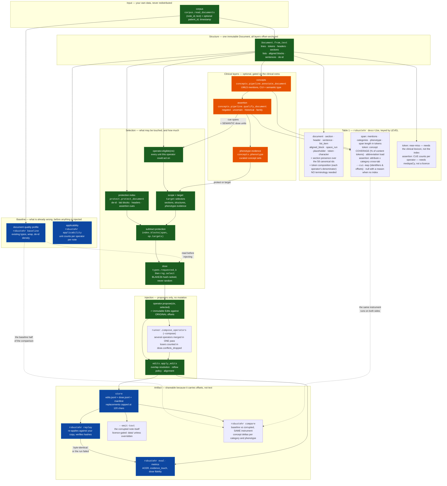

# The pipeline, end to end: corpus in, replayable edit script out

This is the flow a `robustehr run` actually takes, from unperturbed notes to a
committed edit script that reproduces byte-identically on someone else's copy of
the data. Every box names the module that owns it, so the diagram can be checked
against the code rather than believed.

Two properties are worth stating before the picture, because everything in it is
arranged to preserve them.

**Offsets are into the note as written.** Operators are pure proposers: they
never mutate text, never observe each other's output, and never sample. What a
run emits is a list of `(start, end, replacement)` edits against the original
document, which is why applying that list is deterministic and why the artifact
can be shared without shipping the notes. Every field a run writes is defined
in [`run-artifact.md`](run-artifact.md).

**Nothing is measured that was not first counted.** Every operator declares a
*dose unit*, the pipeline counts how many of those units exist, subtracts the
ones protection withholds, and only then selects. A severity of 0.30 means 30% of
what was actually available, and the difference between "eligible" and "total" is
reported rather than hidden.

### Dose, concretely

One note, one operator, from a real run:

| field | n | what it is |
|---|---:|---|
| `total_n` | 63 | negation cues in the document |
| `scope_n` | 63 | after the scope filter |
| `protected_n` | 3 | withheld by the protection registry |
| **`eligible_n`** | **60** | **the denominator severity is a fraction of** |
| `requested_k` | 60 | severity 1.00 × 60 |
| `applied_n` | 60 | edits that survived overlap resolution |

Severity 0.30 would mean 30% of **60**, not of 63. Dividing by `total_n` would
report a dose the run never delivered, because three of those cues sat inside
de-identification placeholders that no operator is permitted to touch.

**Two denominators, and a robustness claim should quote the second.** The dose
record counts *cues*, because a cue is what gets edited. A clinical reader asks
about *concepts*, because a concept is the unit of meaning — and they are not the
same number, since one cue can govern several mentions (`no fever, chills or
cough`). Measured over 20 notes at severity 1.00, the concept-level flip rates
are `negated` 1147/1176 = 0.975, `uncertain` 389/392 = 0.992, `historical`
300/300 = 1.000, `family` 94/115 = 0.817
(`validation/measurements/assertion_invention.json`).

### The perturbation removes modifiers and does not invent them

A stronger property than any flip rate, and one a clinical reader will ask for:
**the pipeline does not add negation, uncertainty, temporality or experiencer to
a concept the note asserts plainly.**

By construction it cannot — eligibility enumerates cues ConText *already found*,
so an unmodified concept is never a target. But that argument is not sufficient,
because an edit changes the text and the detector re-reads the changed text.
Removing one cue can expose another it was covering. So it is measured on the
output:

| operator | unmodified concepts | gained a modifier | rate |
|---|---:|---:|---:|
| `temporality_shift` | 12,726 | **0** | 0.000% |
| `experiencer_shift` | 12,801 | **0** | 0.000% |
| `uncertainty_flip` | 12,777 | 5 | 0.039% |
| `negation_flip` | 12,727 | 30 | 0.236% |
| **overall** | **51,031** | **35** | **0.069%** |

Not zero, and the exception is instructive rather than a defect: deleting `no`
from *no concern for sepsis* leaves *concern for sepsis*, which ConText reads as
POSSIBLE_EXISTENCE. The operator targeted a negation cue and never touched the
concept — the re-read is what changed. That is why `negation_flip`, which deletes
more often than it substitutes, carries almost all of it.

---

## The flow



---

## Reading the flow as a method

**Baseline before injection, and it is not decoration.** `robustehr baseline`
profiles the degradation a corpus *already* carries — misspelling rate, wrap
irregularity, de-identification density. A robustness result that injects 5%
typos into text already carrying 3% is reporting 8% and calling it 5%. The
profile is read before choosing a severity, which is why the dashed edge runs
from the profile into the dose box rather than nowhere.

**Applicability before running.** Not every operator applies to every corpus: a
note set with no tables has nothing for a table operator to do, and an operator
reporting zero edits is ambiguous between *inapplicable here* and *broken*.
`robustehr applicability` resolves that ambiguity in advance.

**The clinical layers are optional and the pipeline says so.** They are two
separate things. Without a QuickUMLS index built from your own UMLS licence
there are no concept mentions, and a phenotype target runs on its surface forms
alone. Without the `clinical` extra there are no assertions, and the SEMANTIC
channel reports zero eligible units rather than failing. Neither is needed to
run and replay every structural, input and lexical operator.

**Protection is subtracted, never assumed.** The subtraction happens *between*
eligibility and dose, so the denominator is what was genuinely available.

### The protection classes

Each operator declares which classes it may target; everything else is withheld.
Prevalence is per 15 discharge summaries.

| class | strength | n | what it protects | validated against |
|---|---|---:|---|---|
| `deid_placeholder` | **HARD** | 1,203 | de-identification markers | underscore runs enumerated from raw text — **coverage 1.0000** |
| `divider_rule` | SOFT | — | ASCII horizontal rules | same enumeration; long runs correctly split from placeholders |
| `numeric_value` | SOFT | 3,773 | any number | digit membership — **precision 1.0, recall 1.0** |
| `list_marker` | SOFT | 1,135 | bullets and enumerators | *no external reference* |
| `dosage` | SOFT | 1,009 | drug amounts and units | *no external reference* |
| `section_header` | SOFT | 770 | headings | *no gold* — 87.0% matched the shipped lexicon, the rest heuristic |
| `lab_block` | SOFT | 162 | aligned result tables | *no external reference* |
| `assertion_cue` | SOFT | — | negation, hedge, history, kinship cues | the stage-8 benchmarks |

**HARD does not mean untouchable, and reading it that way measures the wrong
thing.** A HARD span is refused to any operator that has not declared its class,
and to one that has *unless the edit replaces the span whole*. Deleting a whole
sentence containing `___` removes the marker cleanly; `render.deid_restyle`
rewriting `___` into another scheme replaces it whole. What must never happen is
a **partial** edit leaving `_x_` — a mangled marker that reads as content and
would corrupt any downstream de-identification measurement.

That end-to-end property is measured rather than argued, because the runner
filters eligible *units* against protection and never *edits*:

> **47,827 edits from 20 operators, 3,091 touched a HARD span, 0 violations** —
> 0 undeclared, 0 partial. (`validation/measurements/protection_audit.json`)

**Three classes have no independent ground truth**, and that is stated rather
than papered over. `lab_block`, `dosage` and `list_marker` are layout judgements
with no external reference corpus; their counts are reported and their accuracy
is not established. A result leaning on them would rest on an unmeasured
component. The de-id figure is also **scheme-specific**: MIMIC-IV writes
placeholders as underscore runs, and a corpus using `[**Name**]` or `<REDACTED>`
needs its own `DeidScheme` before that 1.0000 means anything.

**Selection is hash-ranked, not sampled.** `rng.select` orders units by a BLAKE2b
digest of the unit's content-addressed id and the run's seed material. The same
note, operator, version, parameters and salt select the same units on any machine
— and because severity is deliberately excluded from the seed, a severity ladder
*nests*: the units chosen at 0.10 are a subset of those chosen at 0.30.

**Apply is where composition is resolved.** Two operators can propose edits that
overlap; the applier rejects rather than interleaves, and records why. Reflow
policy lives here too, so an operator replacing a span that contains newlines
cannot silently flatten a hard-wrapped note and smuggle in a second perturbation.

**Replay is the test, not the convenience.** `robustehr replay` takes the edit
script and your own copy of the notes and re-derives the perturbed text, checking
hashes cell by cell. If it does not reproduce, the run is not a result.

---

## Where the LLM sits, and why replay still holds

The optional LLM-backed SEMANTIC operators are the one place where a run is not a
pure function of its inputs. The flow accommodates them without weakening the
artifact, and the reason is structural rather than a concession:

```mermaid
flowchart LR
    CUE["assertion cue<br/>(the dose unit)"] --> SENT["its sentence"]
    SENT --> MODEL["configured model<br/>via OpenRouter"]
    MODEL --> CACHE[("response cache<br/>key = model + exact prompt")]
    CACHE --> DIFF["minimal diff<br/>trim common prefix + suffix"]
    DIFF --> GUARD{"guards"}
    GUARD -->|"too long · protected span<br/>· empty · already rewritten"| FALL["deterministic<br/>table edit"]
    GUARD -->|"passes"| EDIT["Edit against<br/>ORIGINAL offsets"]
    FALL --> EDIT
    EDIT --> SCRIPT["edit script"]
    SCRIPT --> RE["replay:<br/>byte-identical, offline, forever"]

    classDef net fill:#b71c1c,stroke:#c62828,color:#fff
    classDef det fill:#1b5e20,stroke:#2e7d32,color:#fff
    class MODEL net
    class CACHE,DIFF,GUARD,FALL,EDIT,SCRIPT,RE det
```



**An operator is a proposer, so non-determinism stops at the edit script.** Once
the script exists, applying it is byte-identical forever regardless of what
proposed it — verified end to end: a run over three notes with both the table and
the LLM negation operators replays 6 cells, 0 failures. What an LLM breaks is
*regeneration*, and the response cache closes that: with the cache present,
re-deriving the same script is offline and identical.

**Four guards, all automatic**, because these run unattended over a corpus:
the minimal diff bounds the blast radius to what the model actually changed; the
replacement is refused if it exceeds `store.MAX_REPLACEMENT_CHARS`, because an
edit script is redistributable *only* by carrying offsets rather than text;
the edit span is checked against the protection registry, since the runner
filters eligible *units* and never *edits*; and anything failing falls back to
the deterministic table edit, so a dose is never silently short.

**Opt-in with no default model.** Unset `ROBUSTEHR_LLM_MODEL` means zero eligible
units and no network. Naming a model is a disclosure decision — see the README.

---

## What each stage is validated against

| stage | instrument | current figure |
|---|---|---|
| structure | segmentation baseline vs PyRuSH | `segmentation_baseline.json` |
| concepts | SNOMED CT Entity Linking Challenge | `phenotype_eval.json` |
| assertion, negation | Chapman NegEx gold, 2,365 spans | F1 0.9289 |
| assertion, all four | 1,000 MIMIC spans, two LLM annotators | κ 0.845–0.913 inter-annotator |
| operators | invariance under κ canonicalizers | flip rate 0.0039 |
| SEMANTIC flips | injection–recovery, both mechanisms | `assertion_flip_recovery.json` |
| determinism | two-process byte-identical replay | `robustehr replay` |

The assertion stage is the one whose own error is largest and is therefore
reported beside every dose it denominates — see
[`assertion-benchmarks.md`](../validation/pipeline/assertion-benchmarks.md) for the three-family
detector comparison and
[`validation/record/methodology/12-context-qualification.md`](../validation/record/methodology/12-context-qualification.md)
for the argument.

---

## Running it

```bash
robustehr baseline      --corpus notes.csv          # what is already degraded
robustehr applicability --corpus notes.csv          # which operators apply here
robustehr run           --corpus notes.csv --out run/ \
    --operators semantic.negation_flip --severities 0.30
robustehr replay        --run run/ --corpus notes.csv    # must verify, or it is not a result
```
