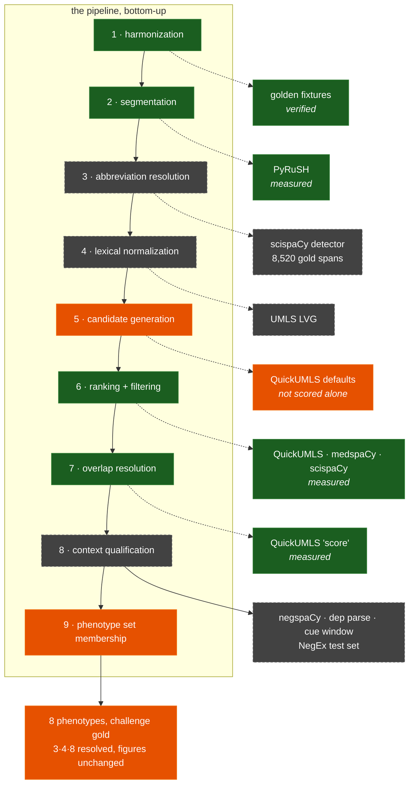

# Validating what RobustEHR tags

What the package claims is not "we can do clinical NER". It is narrower and more
checkable: **when we say an edit landed on a medication, it landed on a
medication.** This document says how that claim gets a number.

The categories themselves are defined in
`src/robustehr/resources/semantic_categories.yaml`, which carries the crosswalk
from each category to the gold-standard label that adjudicates it. That file is
the specification; this one is the protocol.

## 0. The validation ladder: every stage, its baseline, its benchmark

The organizing principle, and the thing a reviewer should be able to check first.

**Every stage is validated against the tool it replaces or reuses, not against
its own intuition.** A stage that cannot beat the established component is
supposed to *be* the established component — the package's stated position is
that reusing a validated tool and measuring the delta is worth more than
reimplementing one and claiming parity. Where we do adjust a reused component,
the adjustment is benchmarked specifically against the unadjusted baseline.

**Stages are validated bottom-up**, because a number produced at stage 9 by a
pipeline missing stage 3 is not a measurement of stage 9. Every stage-9 figure is
reported with the pipeline configuration that produced it, and re-measured when
a stage beneath it changes.

| # | Stage | Baseline compared against | Benchmark | Metric | Status |
|---|---|---|---|---|---|
| 1 | Harmonization — NFC, hashing, offsets | — (no external tool does this) | golden fixtures | offset round-trip, byte identity | **verified** |
| 2 | Segmentation — lines, sentences, sections, headers, lists, lab blocks | **PyRuSH** (medspaCy) | MIMIC-IV discharge summaries, 200 notes | boundary agreement + disagreement taxonomy | **measured** |
| 3a | Abbreviation expansion — **structural** | emitter off vs on, same matcher | SNOMED challenge, `procedure` | recall / precision | **measured** — 0.415 / 0.382, from 0.312 / 0.325 |
| 3b | Abbreviation expansion — **monosemous** | structural emitter without the table | 8,520 abbreviation-shaped gold spans (36.8% of the corpus) | `procedure` / `lab_measurement` recall | **measured** — 0.502 / 0.490 |
| 3c | Abbreviation expansion — **contextual** | most-frequent-sense prior, fitted on train | SNOMED challenge, 7 forms, 188 held-out occurrences | accuracy–coverage | **measured** — 0.229 coverage at 0.977 |
| 4 | Lexical normalization | `MRXNS_ENG`; edit-distance correctors | 3,557 missed spans; 5,372 corrupted words | ceiling gain; recovery | **empty by decision — subsumed into stage 5** |
| 5 | Candidate generation | **QuickUMLS** at published defaults | SNOMED CT Entity Linking Challenge | character IoU | **not scored in isolation** |
| 6 | Ranking and filtering | QuickUMLS defaults; medspaCy; scispaCy linker | same | per-category recall / precision | **measured** — 0.638 / 0.480 |
| 7 | Overlap resolution | QuickUMLS `overlapping_criteria='score'` | same | character IoU, span and concept | **measured** — 0.4543 / 0.1762 |
| 8 | Context qualification | **negspaCy, dependency parse, cue window, majority class** — *not* medspaCy ConText, which is the instrument we ship, not a rival | NegEx test set (2,365 spans); BioScope for uncertainty | negated-class F1 | **measured — 0.9289 vs 0.0000 floor**; uncertainty 0.2511 out of domain |
| 9 | Phenotype set membership | — (no comparable tool) | 8 phenotypes over the challenge gold | span recall, set recall | **measured** — 0.912 / 0.698 |



Read the diagram as the claim it is: a stage is only as validated as everything
beneath it, so the orange node is orange **because** three grey nodes sit under
it, not because its own measurement is weak.

### Every stage has a baseline counterpart, and they are never summed

A pipeline stage and a corruption channel are often the same dimension seen from
two directions. The stage asks *how much of this is already in the note*; the
operator asks *how much more can be added, at measured dose*. Where both exist,
pairing them makes a robustness result conditionable — "recall fell 6 points
under this operator" reads differently in the top baseline tertile than in the
bottom.

**Not every channel has one, and inventing one would be worse than the gap.**
A stale copy-forward operator or a same-class medication swap — neither is
registered today; see `docs/corruption-taxonomy-status.md` rows 6 and 29 — would
corrupt content whose baseline is a clinical judgement rather than a countable
property, and a proxy nobody validated is a number that invites conditioning on
noise. The table
below covers the channels where a baseline is genuinely operationalizable; the
others report dose alone, which is honest.

| # | Stage | Corruption channel | Baseline measure |
|---|---|---|---|
| 2 | segmentation | `render.break_removal`, `render.whitespace_collapse` | `wrap_width`, `ragged_line_variance`, `whitespace_runs` |
| 3 | abbreviation expansion | — *(no operator yet)* | `abbreviation_load.json` — 0.409 ambiguous, 0.156 highly |
| 4 | spelling normalization | `input.typo` — substitute, transpose, delete, double | `misspelling_rate` — median 0.004, **recovers 74% of an injected dose** |
| 4 | scanning noise | `input.ocr_confusion` — glyph, ligature | `metrics.ocr.profile_ocr` — OOV tokens reachable from a known term by one **inverse** confusion, over the same table the operator injects with |
| 4 | medication naming | `lexical.medication_rename` | `metrics.medications.profile_medications` — generic / commercial / undetermined shares over UMLS medication mentions |
| 8 | assertion | `semantic.negation_flip` and siblings | cue density via `context.cue_units` — `UnitKind.ASSERTION` now has a producer |
| — | de-identification | `render.deid_restyle` | `deid_placeholders`, `deid_schemes` |

**Baseline and injected dose are never added together.** A note already carrying
a 0.9% typo rate that receives a 3% injection is not at 3.9%: the operator's
denominator is *eligible units*, the baseline's is *content tokens*, and the two
overlap in ways no arithmetic recovers. The baseline is a **stratifier**, not a
term. That rule is stated at length in `validation/methodology/04-dose-accounting.md` and is
the reason this table pairs the two rather than combining them.

The gaps are the useful column: **stage 8 has an operator planned and no baseline
measure**, and stage 3 has a baseline measure and no operator. Both are real work,
and naming them is cheaper than rediscovering them.

**The OCR row has a gap of its own, and it is asymmetric.** `profile_ocr` shares
the operator's confusion table — forward to inject, inverse to detect — which is
the tightest pairing in this document. But it cannot see the half that matters
most: `5.1` misread as `S.1` is exactly what the digit rows exist to inject, and
a number that came off a scanner wrong still looks like a number, with no lexicon
to check it against. Digit-bearing tokens are therefore excluded from the estimate
rather than counted badly. It also under-counts at high dose by construction, since
a word that took two substitutions is no longer one inverse edit from a real word.
It is an instrument for detecting whether scanning noise is present and watching it
move, not for measuring how much. See `validation/methodology/15-input-channel-errors.md`.

**A baseline measure owes the same validation as anything else.** The
misspelling estimator is the one case where that has been run, by
injection–recovery against `input.typo` — the two are dual, so a known injected
dose can be compared with the estimate. It **fails the release gate**: slope
0.7401 against a required [0.90, 1.10]. See `spelling_methods.json`; the finding
is that it is a consistent under-count rather than a noisy one, which changes how
it may be used but not whether it may be.

### What "validated" means at each rung

The word does different work at different stages, and collapsing the
distinctions is how a validation section becomes unfalsifiable.

| Level | Meaning | Failure is |
|---|---|---|
| **verified** | a machine-checkable invariant holds over the corpus | a bug |
| **measured** | a number against an external reference, with its baseline | a reported rate |
| **conditional** | measured, but on a pipeline with unbuilt stages beneath it | a number that will move |
| **inherited** | the reused component's own published evaluation applies | forfeited by any parameter change |

**No rung is currently inherited, and that is a change worth stating.** Stage 5
was the one candidate, and the inheritance is asymmetric in a way §7 spells out:
narrowing QuickUMLS's semantic-type filter yields a subset of what they validated
and keeps their evaluation; widening it returns spans they never scored and does
not. But the shipped configuration now sets `overlapping_criteria='length'`, and
`benchmark_history.json` records `inherits_quickumls_validation: false` for it.
The package took on its own evaluation obligation when it changed the overlap
policy, and §7's parameter list has been corrected to say so.

### Stage 2 in detail — the one with no gold standard

Worth spelling out because its validation is shaped differently from the others,
and because the shape is forced rather than chosen.

There is no clean public sentence-boundary gold for MIMIC discharge summaries.
Annotating one ourselves would make the reference our own judgement again, which
is the exact problem external validation exists to solve. So stage 2 is measured
as **agreement with PyRuSH plus a full classification of the disagreements** —
and the taxonomy, not the agreement figure, is the result.

Measured over 200 notes (`validation/pipeline/scripts/segmentation_baseline.py`): 52,809 boundaries
against PyRuSH's 65,824, agreeing on 33,209 — a Jaccard of 0.389.

That number alone would be uninterpretable, and reporting it alone would be
misleading. The two systems disagree **by design, not by accuracy**:

| Disagreement class | Ours only | PyRuSH only | Who is right |
|---|---:|---:|---|
| line break, no terminal punctuation | 8,578 | 605 | **ours** — clinical notes are line-structured |
| de-id placeholder | 5,867 | 2,848 | **ours** — see below |
| after a colon (header or label) | 3,958 | 334 | **ours** — `HEENT: PERRLA` is a unit |
| after terminal punctuation | 572 | 6,320 | **PyRuSH**, mostly |
| mid-line, no cue | 473 | 6,964 | **ours** — PyRuSH is splitting hard-wrapped prose |

The de-id row is the one that matters most, and it was a stated hypothesis
before the comparison ran. PyRuSH splits *inside* the MIMIC header block, cutting
`Admission Date: ___ | Discharge Date:` mid-line, because a placeholder looks
like a sentence end to a splitter that does not know what a placeholder is.
`probe_deid_assertion.py` already showed the downstream cost: a spurious boundary
lets a negation cue take scope over the next clause and flips an active diagnosis
to negated. Our splitter is de-id-aware by construction and does not.

PyRuSH's `mid-line, no cue` column is the same failure in a different guise —
6,964 splits inside hard-wrapped prose (`benadryl 50mg x2, | IV lorazepam`),
where the newline is a rendering artifact rather than a sentence end. That is
precisely the wrapping the RENDER channel perturbs, which is why this package
segments structure itself instead of delegating.

**The comparison also found a bug of ours**, which is the honest half of the
result and the argument for doing it at all. We were splitting lab lines at
values written without a leading zero — `Lipase 54 / TB . | 5 / Alb 3.2` —
because the tokenizer merges `4.46` into one atom but cannot merge a point with
no digit before it, so `.5` reached the boundary rules as punctuation followed by
a number. 50 spurious boundaries across 200 notes. A whole error class our own
golden fixtures never contained, found in an afternoon by running someone else's
splitter over the same text. It is fixed and pinned in
`tests/unit/test_sentences.py`.

### Stage 3 — measured before it was built

The abbreviation-resolution ceiling was measured before the stage existed
(`abbreviation_ceiling.json`): over 8,520 abbreviation-shaped gold spans the
shipped matcher scores 0.4346, exact lookup at `min_match_length=2` 0.4837, and a
perfect disambiguator over UMLS 0.5511, so every disambiguation policy competes
for 6.7 points while 44.9% of the spans have no UMLS candidate with the right
category at all — `creat`, `rbc`, `hgb`, `rdw`, `angap`, `heent`, lab and exam
shorthand the vocabulary does not contain as strings. Abbreviation resolution in
this corpus is a vocabulary problem, so the component is a surface-form
expansion table (stage 3a/3b) rather than a disambiguation cascade, and the
contextual rung (3c) is measured on its own accuracy–coverage curve.

### What each stage owes before the manuscript

| Stage | Outstanding |
|---|---|
| 2 | section boundaries against **MedSecId** (PhysioNet, MIMIC-III section annotations) — currently unvalidated separately from sentences |
| 3 | **done** — the expansion table, not the cascade (see the V0 finding). Owed next: an accuracy–coverage curve against scispaCy's detector |
| 4 | **closed, not owed.** Gated twice and deliberately left empty: a normalized lookup reaches 11.8% of the miss set at 17.6% precision, and the best spelling corrector recovers 53.0% at 54.8% accuracy. Recorded as *subsumed* by the matcher's approximate matching, not *missing* — see `validation/record/methodology/11-lexical-normalization.md` |
| 8 | **done** — negated-class F1 against the NegEx test set, six arms (`assertion_accuracy.json`); invariance across seven de-identification conventions (`assertion_deid_invariance.json`); rule-count disclosure for the four attributes with no gold (`context_rule_inventory.json`). Owed next: uncertainty gold from BioScope; ShARe/CLEF 2014 if credentialed access is obtained |
| 9 | **re-measured** after 3, 4 and 8 resolved — reproduces byte for byte, so the conditionality is discharged and the `heart_failure` stage-3 attribution is retracted. Owed next: clinician review of each shipped concept set |

## 1. The categories, and what evidence each has

Eleven categories in three tiers. The tier travels with every result, so a
reader can tell which numbers rest on a gold standard.

| Tier | Categories | What can be claimed |
|---|---|---|
| **anchored** | `disorder`, `procedure`, `anatomy`, `medication` | P/R/F1 against expert annotations |
| **derived** | `disease`, `symptom`, `finding`, `therapeutic_procedure`, `diagnostic_procedure` | the *parent's* metrics; the split is a deterministic refinement |
| **unanchored** | `device`, `lab_result` | usable and labelled; never a headline claim |

Eleven categories, listed with definitions in [`categories.md`](../docs/categories.md).
`chemical`, `organism` and `physiology` were removed after measurement — see that
file for the numbers that justified each cut.

The tiering exists because every available gold standard is coarser than the
distinctions a phenotyping robustness study needs. Splitting `disorder` into
disease vs symptom is clinically necessary — "the model missed the diagnosis" and
"the model missed the symptom" are different failures — but no corpus adjudicates
that split, and claiming it is validated because `disorder` is would be precisely
the overclaim the tiers prevent.

A load-time check enforces that a derived category's semantic types are a subset
of its parent's, because a child escaping its parent would report results under a
boundary that does not contain them.

## 2. Crosswalk to the gold standards

| Gold standard | Corpus | Size | Validates |
|---|---|---|---|
| **`snomed_el`** — SNOMED CT Entity Linking Challenge | **272 MIMIC-IV discharge notes** | 75,491 annotations of 6,595 concepts as released (74,808 / 6,624 as published), 6 clinical annotators, ~70% double-annotated | `disorder` (clinical finding), `procedure`, `anatomy` (body structure) |
| **`n2c2_2018`** Track 2 | MIMIC-III discharge summaries | ~500 notes | `medication` (drug) |
| `i2b2_2010` | Partners / BIDMC / UPMC | 170 train, 256 test | `disorder` (problem), `procedure` (test+treatment), `medication` (treatment, partial) |
| `share_clef` 2013–14 | clinical notes | — | `disorder`, plus the assertion layer |

`snomed_el` is primary: same corpus family as the development notes, so it tests
the tagger on the text it will actually run on. Its one gap is that it carries no
medications — deliberately only three SNOMED hierarchies — which is why
`n2c2_2018` is not optional.

## 3. Two different measurements, and only one of them is the package's claim

**Experiment A — tagger quality (standard NER/linking evaluation).**
Run the tagger over the gold corpus, map gold labels to our categories via the
crosswalk, and report strict and relaxed precision, recall and F1 per anchored
category, with cluster-bootstrap confidence intervals **by `patient_id`**, never
by note — clinical corpora repeat patients and copy-forward makes their notes
genuinely correlated.

This is the number a reviewer will ask for. It is not, on its own, what the
package needs to be true.

**Experiment B — targeting fidelity (the claim that actually matters).**
For edits placed under a target of category *X*, what fraction overlap a gold
span whose crosswalked label is *X*?

```
targeting_precision(X) = |edits on X that hit a gold X span| / |edits on X|
```

This is the honest form of the package's promise. A tagger with mediocre recall
can still support a perfectly sound experiment, because missing a medication only
means we corrupted fewer medications than we could have — the dose accounting
already reports achieved rather than requested. But a tagger with poor
*precision* means the corruption did not land where the results claim it did, and
every downstream conclusion inherits that error.

So **precision is the gating metric and recall is reported for completeness**,
which is the opposite of the usual NER emphasis and needs saying explicitly in
the methods.

## 4. The ablation ladder

Each rung is a change in method, measured on the same gold spans, so the value of
each addition is a number rather than an argument.

| Rung | Method | Question it answers |
|---|---|---|
| **L0** | word-level lookup, current default | what does the cheap method cost? |
| **L1** | + concept-level matching (QuickUMLS via medspaCy) | does multi-word matching fix bare-token false positives? |
| **L2** | + longest-match / overlap resolution | how much do nested mentions matter? |
| **L3** | + ConText qualification | does excluding negated and family mentions improve targeting? — assertion now carried end to end; 30.1% of gold evidence is non-affirmed (`phenotype_assertion.json`) |
| **L4** | + our structural boundaries instead of PyRuSH | **yes.** Invariance 0.0000 against PyRuSH's 0.1429 across seven de-id conventions, and the corpus-scale non-affirmed rate moves 34.7% → 30.1% on identical spans (`assertion_deid_invariance.json`, `phenotype_assertion.json`) |

L0 → L1 is the rung that matters most, because it is the one predicted to remove
the `stairs` / `one` / `date` failures that word-level lookup cannot. L4 is
motivated by an already-reproduced finding: masked placeholders defeat medspaCy's
sentence segmentation and let negation scope leak across list items
(`validation/measurements/deid_assertion_probe.json`).

## 5. The T033 decision — measured, and moot at the mention level

`finding` (T033) was excluded from `clinical_any` **provisionally**, because bare
`stairs`, `one`, `well` and `normal` matched at word level. The field disagreed:
QuickUMLS includes T033 among its 27 default semantic types, MedMentions ST21pv
among its 21, and the SNOMED challenge's `clinical finding` hierarchy is largely
T033.

**Run, on `snomed_el`, with and without T033. Result: no difference — because the
question does not arise where it was posed.** Scored against the gold, the three
variants are identical to three decimal places:

| rule | precision | recall | F1 | coverage |
|---|---:|---:|---:|---:|
| any mention | 0.500 | 0.785 | 0.611 | 45.7% |
| `clinical_any` (T033 excluded) | 0.500 | 0.785 | 0.611 | 45.7% |
| `clinical_any` + T033 | 0.500 | 0.785 | 0.611 | 45.7% |

The reason is mechanical: **100% of the mentions the matcher returns already
carry a `clinical_any` category**, because the TUI whitelist is applied when the
matcher is configured, upstream of any category filter. There is no
`finding`-only mention for the exclusion to act on. Zero mentions change hands.

So the decision stands as written, but its *rationale* is corrected: T033's
exclusion is not doing the work it was credited with. Whatever was suppressing
`stairs` and `one` at word level, it was not this flag. The measurement that
does discriminate is [§9](#9-clinical-targeting-for-concept-restricted-corruption),
and it operates on tokens rather than semantic types.

This remains the template for every judgement call in the taxonomy: state it,
mark it provisional, let a measurement close it — and accept that the
measurement may close it by showing the question was mis-posed.

## 6. Reporting rules

- **Tier travels with the number.** A result on `disease` says `tier: derived`
  and points at `disorder`'s metrics. No result silently inherits its parent's
  credibility.
- **Cluster-bootstrap by patient**, never by note.
- **Precision gates, recall informs** (§3).
- **Absolute counts next to every rate**, and no stratum with fewer than ~50
  positives reported as a rate on its own.
- **Unanchored categories are never a headline.** They may appear in a
  supplementary table, labelled.

## 7. What is inherited from QuickUMLS, and what is not

Re-deriving a published result is waste. The question is which parts of
QuickUMLS's validation transfer to our configuration, and the answer is settled
by how it implements the semantic-type filter rather than by argument.

**`accepted_semtypes` is a post-match filter.** In `quickumls/core.py`,
`_is_ok_semtype` is called at line 338, *after* ngram generation, simstring
lookup and similarity scoring, as a `continue` on candidate concepts. Restricting
it cannot create a span, move a boundary, or change a similarity score — it can
only remove candidates.

So restricting to our semantic types yields output that is a **strict subset** of
the default output. That has a precise consequence:

| Quantity | Inherited? | Why |
|---|---|---|
| Per-semantic-type matching behaviour | **yes** | the algorithm is untouched; ours is a filtered view of the validated output |
| Category grouping (union of TUIs) | n/a | a deterministic set operation — tested, not validated |
| Published P/R on ShARe/CLEF, THYME | **cite, do not repeat** | already measured against MetaMap and cTAKES |
| Behaviour on **our UMLS release** | **no** | 2026AA index content differs from theirs |
| Behaviour on **MIMIC-IV discharge notes** | **no** | different corpus, different genre |
| **Targeting precision** | **no** | a metric they never computed |

**Therefore: no new NER validation is required for the semantic-type
restriction itself.** What must be measured is only the delta — our release, our
corpus, our metric — which is one run rather than a re-derivation.

Any change to `threshold`, `similarity_name`, `min_match_length` or
**`overlapping_criteria`** *does* leave the inherited guarantee, because those
alter the matching algorithm rather than filter its output. Each is recorded in
the run manifest for that reason, and `benchmark.VALIDATION_CRITICAL` is the list
the code checks against.

**The shipped configuration has left it.** `overlapping_criteria='length'` is not
a QuickUMLS default, so the current matcher owes its own evaluation and
`benchmark_history.json` records `inherits_quickumls_validation: false` for every
entry from 22 onward. That obligation is discharged by the head-to-head against
medspaCy and scispaCy and by the challenge score, not by citation.

## 8. What this does not validate

The crosswalk is a mapping between annotation schemes, and mappings lose
information. `i2b2_2010`'s `treatment` covers both procedures and drugs, so it
can only ever partially validate either. `snomed_el` annotates SNOMED concepts,
not UMLS semantic types, so the crosswalk goes through SNOMED's top-level
hierarchies rather than through TUIs directly.

Neither corpus is a validation of the *phenotype* layer, which needs its own
evidence and gets it from the concept lockfiles plus expert audit — a separate
protocol, not this one.

## 9. Clinical targeting for concept-restricted corruption

Experiment 2 corrupts "clinical concepts and not the surrounding prose". That
sentence names a *targeting rule*, and the rule needs its own validation — the
category evidence in §1–§2 does not transfer, because it validates whether a
mention is typed correctly, not whether the tokens we corrupt are clinical.

### What `target: umls` selects, and why it is not the rule

`target: umls` — any span overlapping a matcher mention — is the obvious rule.
Measured on generated corpora, it spends its edit budget like this:

| where the edits landed | share |
|---|---:|
| unambiguously clinical (`coumadin`, `HTN`, `DM2`) | ~25% |
| ambiguous — in both the clinical and general lexicons | ~52% |
| plain general English (`she`, `you`, `please`, `and`) | **~14%** |
| unknown | ~9% |

The ambiguous bucket does not rescue it: its most frequent members are
`patient`, `bid`, `home`, `sig`, `discharge`, `admission`, `likely`, `well`, of
which only 13.8% is plainly clinical vocabulary. **Roughly 30% of the edit budget
reached clinical content**, and 43% of every note's characters fell inside some
mention — a rule admitting 43% of a discharge summary is not concept-targeted.

Section headers were among the spans: `⟦History of Present Illness⟧` and
`⟦Discharge Instructions⟧` are both matcher mentions. Corrupting them under the
label "concept-targeted" **confounds Experiment 2 with Experiment 1's structural
arms**, which is a design failure rather than a precision failure.

### Benchmark

**SNOMED CT Entity Linking Challenge** — 272 MIMIC-IV discharge summaries,
75,491 adjudicated spans, the same corpus type Experiment 2 runs on. Gold is
"a human annotator marked this character as part of a clinical concept".

Scored at **token level**, not span level: corruption is dosed on characters and
words inside a mention, so what matters is whether the token being corrupted is
clinical, not whether some enclosing span was. The distinction is material —
gold spans carry function words with them (`of`, `no`, `to` each appear inside
hundreds of gold spans).

Split is by note, deterministically by BLAKE2b bucket, 223 train / 49 held out.
All numbers below are held-out.

### Result

| rule | precision | recall | F1 | coverage |
|---|---:|---:|---:|---:|
| any UMLS mention (as built) | 0.500 | 0.785 | 0.611 | 45.7% |
| mention ∧ not general-English | 0.551 | 0.648 | 0.596 | 34.2% |
| mention ∧ salience ≥ 0.40 | 0.878 | 0.684 | 0.769 | 22.7% |
| salience ≥ 0.40 | 0.852 | 0.812 | **0.832** | 27.7% |
| salience ≥ 0.50 | **0.890** | 0.767 | 0.824 | 25.0% |
| **adopted rule (four clauses)** | 0.820 | 0.789 | 0.804 | **28.0%** |

Gold rate: 29.1% of word tokens.

Two results worth recording because they are counter-intuitive:

- **Requiring a matcher mention makes it worse.** `mention ∧ salience` scores
  F1 0.769 against 0.832 for salience alone: the matcher's spans exclude
  clinical tokens it failed to match. For deciding what is clinical, a measured
  token lexicon beats the UMLS tagger on this corpus.
- **The adopted rule scores *lower* than salience alone, on purpose.** Its
  precision is understated by construction — see below.

### Why the adopted rule is not the top-scoring one

A salience lexicon learns the annotators' **scope**, not the language. Coverage
of our mentions by the gold, per category:

| category | in gold | | category | in gold |
|---|---:|---|---|---:|
| symptom | 80.6% | | disorder | 56.9% |
| diagnostic_procedure | 74.7% | | therapeutic_procedure | 54.9% |
| lab_measurement | 72.0% | | **device** | **33.6%** |
| disease | 70.8% | | **medication** | **27.2%** |

**21 of 23 common drugs would be rejected as non-clinical.** `metoprolol`
occurs 213 times in the training notes and never once inside a gold span;
`furosemide` 0/85, `oxycodone` 0/152, `albuterol` 0/140. The annotators marked
drugs in prose (`heparin` 0.57, `lasix` 0.64) but not the structured
discharge-medication list. Adopting salience alone would corrupt clinical text
while sparing nearly every drug name.

Laboratory analytes fail the same way through inconsistency rather than scope:
`hct-` 0.99, `hgb-` 0.99, `na-` 0.99, but `amylase-` 0.29, `lipase-` 0.43,
`mcv-` 0.37, `k-` 0.23.

So the adopted rule is a union, each clause added because a measurement showed
the previous rule failing:

```
salience ≥ 0.50                            validated above
∨ token ∈ curated drug vocabulary          gold covers 27% of medications
∨ token inside a structural labelled-value span   analytes inconsistent
∨ (mention ∧ unseen ∧ not general-English) unseen clinical terms
```

Its measured precision of 0.820 is a **floor, not an estimate**: every drug it
correctly selects from a medication list counts as a false positive against a
gold that declined to annotate that list. The medication clause is therefore
validated against a different source — exact membership in the curated
DrugBank/commercial vocabulary — and the `medication` *category* was rejected as
a selector, topping out at 43% precision because `his` → Histidine and `date` →
a pharmacologic compound both match exactly at similarity 1.0.

### What whole-note review caught that the metrics did not

Both failures below were found by reading fully-annotated notes and are
invisible in precision, recall and F1. This is the argument for keeping manual
review in the protocol.

1. **The medication exclusion above.** Aggregate F1 was 0.824 — the best of any
   single rule — while the rule silently spared every drug in the corpus.
2. **`mg` is the token a surface-matched analyte clause corrupts most**, 714
   occurrences: `Mg-1.9` (magnesium, a lab result) makes every `mg` (milligram,
   a dose unit) eligible. The clause is therefore positional — inside the
   labelled-value span rather than equal to its text — at a cost of 1.9 points
   of coverage (29.8% → 27.9%).

### Known residual gaps

- **Multi-word generics** (`Ferrous Sulfate`) are missed: the drug vocabulary is
  single-token by construction, having dropped 375 multi-word generics at build
  time.
- **`lipase-`** is still missed where it is not parsed as a labelled value.
- **Borderline selections** — `status`, `stable`, `clear`, `iv`, `po` — all have
  gold salience ≥ 0.50 and are defensible, but are weaker clinical content than
  the rest.

All three *reduce* clinical coverage, biasing the experiment toward finding no
effect. That is the conservative direction and is reported rather than corrected.

### Reporting requirement

Any Experiment 2 result quotes the targeting rule, the lexicon digest, and the
benchmark it was measured on. "Concept-targeted" without those three is not a
claim this protocol supports — that is exactly what the first build asserted,
and it was wrong by a factor of three.

## 10. The phenotype target: how it is built, reviewed and reported

The method is stated once in
[methodology 17](methodology/17-phenotype-association-method.md); this section
is the protocol a result has to follow when it leans on a `pheno=` target.

A **phenotype target** returns the spans of a note that are evidence for one
phenotype. It admits a span on either of two warrants — the span's concept is in
the phenotype's concept set `C_P`, or its text is one of the phenotype's declared
surface forms `S_P` — and every admitted span records the warrant and tier that
admitted it. Both resources are generated and then gated; a generated set carries
no clinical warrant until something judges it.

**Building `C_P`.** A SNOMED seed expanded through `isa` and `MTH RN` to a
bounded depth gives the disorder facet; MED-RT `may_treat`/`may_prevent` gives
medications, and RxNorm identity relations expand an admitted ingredient to its
brands and forms; a model proposes clinical *terms* per facet and each is
grounded to a CUI by lookup against the local release
(`validation/phenotype/scripts/phenotype_propose.py`); a bounded one-hop
neighbourhood supplies closure candidates
(`validation/phenotype/scripts/phenotype_closure.py`). Every generated candidate
is judged by `phenotype_vet.py` (one verdict per concept, with the model
recorded) and written to `src/robustehr/resources/phenotype_vetting.yaml`;
`build()` intersects on `kept`, a closure candidate with no verdict row is not
admitted, and `tests/test_phenotype_vetting.py` asserts a dropped CUI cannot
reach a built set. Vetting asks whether a concept belongs and is conservative
when asked that way, so its drops are revisited by a stronger model under the
opposite bias (`phenotype_reconcile.py`): a reinstatement overrides a rejection,
nothing already accepted is revisited, and both verdicts are recorded.

**Building `S_P`.** `validation/phenotype/scripts/phenotype_anchors.py` asks a
model for the forms a clinician writes to mean each diagnosis, insisting on
elliptical and abbreviated forms; a review pass keeps every form except one
that carries an established different clinical meaning a reader could intend.
The terms the grounding step could not resolve enter at tier `associated`
(`phenotype_ungrounded.py`). The same resource declares stop surfaces — strings
that are legitimate vocabulary entries for an in-set concept and ordinary
language in the note — refused on either warrant, with a general-English floor
beneath them. The resource is author-written English and ships in the clear.

**Clinician review.** `phenotype_export_review.py --no-disorder` writes one TSV
per phenotype under `data/phenotype_review/` (UMLS terms in the clear,
gitignored), model drops sorted first. A blank `keep` cell leaves the model's
verdict; `y`/`n` overrides it. `phenotype_review_ingest.py --reviewer <name>`
folds the marked files back: human rows carry a `reviewer` field the model rows
never do, the file's `vetted_by` moves to `llm+clinician`, and the override
count per phenotype is recorded. After ingest — or after any change to the
vetting, closure or anchor resources — regenerate in order: `phenotype_closure.py`,
`phenotype_set_audit.py`, `phenotype_runtime_sets.py`, `phenotype_link_audit.py
--facets --full`, `phenotype_corpus_coverage.py`, and `phenotype_eval.py --limit
300 --overlap length --trim-affixes --prefer-snomed`, whose union recalls travel
back into `phenotypes.yaml`.

**Review states.** A resource's `vetted_by` is one of `llm` (models only),
`llm+hand` (an author curated forms by hand after the model passes; editorial
review, not a clinician's review of record) or `llm+clinician` (a clinician has
read the review sheet end to end); `absent` is reported for a resource that
predates the field. The anchor resource ships as `llm+hand`; the vetting file as
`llm`. `concepts/surface.py` validates the state at load.

**Corpus coverage, measured.** `phenotype_corpus_coverage.py` reads the mention
cache and reports, per phenotype, declared / reachable / observed concepts, the
unobserved split, mention concentration and the enrichment screen; `phenotype_
gap_audit.py` measures reach against an independently written term list, by
warrant. Union precision is not measured.

### Reporting requirement

A result that leans on a `pheno=` target reports the run manifest's `targeting`
block, which names: the digest of every packaged targeting resource
(`phenotypes.yaml`, `phenotype_vetting.yaml`, `phenotype_closure.yaml`,
`phenotype_proposals.yaml`, `phenotype_anchors.yaml`, `phenotype_nonspecific.yaml`),
present or `absent`; the `targeting_digest` over the strings the anchor resource
admits and refuses; `anchors_vetted_by` and `vetting_vetted_by`; and the digests
of the locally built `umls_facets.json`, `isa` hierarchy and crosswalk. It also
names the coverage artifact for the corpus it ran on and the eval-run date behind
any recall it quotes. `absent` is a reportable state rather than a missing
field: a corpus built before a resource existed was built under a different
target, and saying so is what keeps two runs comparable instead of conflated.

It reports **reach by tier**, not only coverage of declared evidence.
`PhenotypeIndex.declared_by_tier` and `touched_by_tier` share a denominator, so
a result states what share of the phenotype's *diagnosis* a perturbation
reached. A run reporting full coverage of declared evidence while touching none
of the written diagnosis is reporting the number that is easier to make large.
