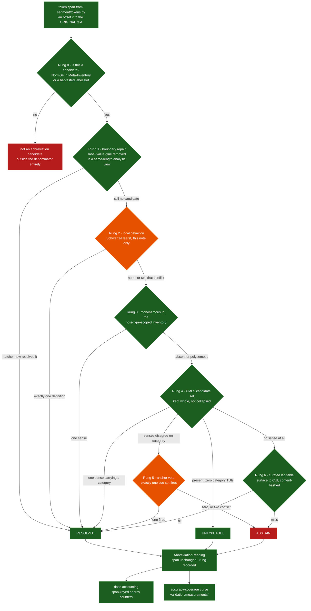

> **Development record.** This document was written while the component it
> describes was being built and reads as a history. The method as it stands is
> in [`validation/methodology/`](../methodology/); nothing here is cited by the
> manuscript. Kept so every decision can be audited.

# Abbreviation resolution — implementable specification

Stage 3 of [`concept-matching-pipeline.md`](concept-matching-pipeline.md), which
that document marks **missing** and names as the next real lever. This is the
build order, the evidence behind each decision, and the parts that are
explicitly not being built.

Four independent investigations and four adversarial reviews went into this. The
single most consequential finding is that **the stage was misdiagnosed**. "94% of
missed gold spans are single-word lab abbreviations" is true, and the inference
drawn from it — that we need an abbreviation resolver — is mostly wrong. Three
quarters of that miss volume is a *tokenization boundary* failure on strings that
are already in UMLS and already in the index. It needs no terminology work at
all.

Everything below carries the measurement that produced it. Numbers marked
**(verified)** were re-measured directly against `data/umls/2026AA`,
`data/snomed_el/` and the live `data/quickumls_index` while writing this
document. Numbers marked **(proxy)** were measured by a review using a stand-in
implementation and have not yet been reproduced by an artifact in
`validation/measurements/`.

---

## 1. The problem, with the numbers

### 1.1 The miss set

| Quantity | Value |
|---|---|
| Gold spans, SNOMED CT Entity Linking Challenge, 272 MIMIC-IV discharge notes | 75,491 **(verified)** |
| Single-token gold spans | 52,806 — 69.9% **(verified)** |
| Gold spans the current matcher misses entirely, at package defaults | 19,965 — 26.4% |
| …of those, single-token | 18,832 — 94.3% |
| Distinct missed surface forms | 1,617; top 100 cover 74.5%, top 1,000 cover 96.9% |

The miss set is small and enumerable. That matters more than its size: 1,617
distinct strings is a closed problem, not an open-ended vocabulary gap.

### 1.2 It splits into four failures, and they are not the same size

The word "abbreviation" covers four distinct defects with wildly different
volumes and wildly different fixes. Conflating them is what produced the wrong
build order.

| | Failure | Volume | What fixes it |
|---|---|---|---|
| **A** | **Boundary.** The string is in UMLS and in the index, but the matcher never sees it as a candidate because the label is glued to its value: `Hgb-9.9`, `AnGap-16`. | 9,951 gold spans — 13.2% of all gold **(verified)**; 9,194 of the 19,965 misses — **46.1%** | a length-preserving analysis view. No terminology work. |
| **B** | **Absence.** The string is in no terminology at any term type or suppression level. | 32 of 130 gold-bearing lab-label surfaces, 2,352 occurrences — 3.12% of gold | a small curated table with hand-assigned CUIs |
| **C** | **Wrong sense.** The string is present and resolves confidently to the wrong concept. | `ra` alone is 298 spans, 287 of them room air **(verified)**; category-disagreeing polysemy is 11.5% of abbreviation occurrences | context evidence, and abstention when it is absent |
| **D** | **Local definition.** `shortness of breath (SOB)` defined in the note itself. | **17 of 19,965 misses — 0.085%**, 13 of them in one echo report | Schwartz–Hearst. Measured negative on this genre. |

### 1.3 Failure A, demonstrated

Run against the live index at package defaults **(verified)**:

```
ConceptMatcher().annotate("WBC-6.9 RBC-4.46 Hgb-12.8")   ->  []
ConceptMatcher().annotate("WBC 6.9 RBC 4.46 Hgb 12.8")   ->  WBC  C0023516 T025
                                                             RBC  C0014792 T025,T121
                                                             Hgb  C0019029 T034
ConceptMatcher().annotate("Creat-1.2 UreaN-30 AnGap-14") ->  []
ConceptMatcher().annotate("Creatinine 1.2")              ->  C0201975 T059
```

One character decides whether three correct mentions appear or none do. The
terms are in the vocabulary; QuickUMLS's n-gram generator never offers them
because its token is `Hgb-12.8`. `glucose` is missed 383 times and `calcium` 272
times in this corpus despite both being unambiguously in UMLS — which is the
cleanest possible proof that the dominant miss mode is not a vocabulary problem.

Structurally, these sit in a place the package already detects:
`segment/blocks.py::detect_aligned_blocks` reports `self_labelling`
`ALIGNED_SPACES` blocks in 100% of development notes, and its own module
docstring uses `WBC-6.9 RBC-4.46 Hgb-12.8` as the example. 9,378 gold spans —
12.4% of all gold, and **75.6% of all 12,283 T059 Laboratory Procedure gold
spans** — sit exactly on the label token of a `Label-Value` pair inside one.
The current matcher detects 6–7% of those against ~84% elsewhere, which is the
entire `procedure` recall deficit of 0.3096 recorded in `head_to_head.json`.

### 1.4 Failure B, and the correction to the pipeline doc

`concept-matching-pipeline.md` states that five terms — `angap`, `crea`,
`creat`, `rdw`, `urean` — are absent from UMLS. **They are, and the claim needs
strengthening rather than weakening**, but the probe itself was case-folded and
that made two later investigations chase artifacts.

Scanning the `STR` field of `MRCONSO.RRF` 2026AA — column 15, not a substring
grep, which is what produced two false "actually it is present" corrections
**(verified)**:

```
crea  creat  angap  urean  rdw  rdwsd  totbili  ctropnt   ->  0 rows, any TTY, any SUPPRESS
```

And in the gold, the lowercase probe forms do not occur at all **(verified)**:

| probe form | gold occurrences | real surface | gold occurrences |
|---|---|---|---|
| `angap` | 0 | `AnGap` | 348 |
| `creat` | 0 | `Creat` / `CREAT` | 381 / 93 |
| `rdw` | 0 | `RDW` | 491 |
| `urean` | 0 | `UreaN` | 368 |
| `crea` | 0 | — | does not exist |

**Action:** correct the 24-term probe in `concept-matching-pipeline.md` to the
case-sensitive surfaces and drop `crea`. Four terms, not five.

LOINC does not close this gap. It is installed as `SAB=LNC` with 91,382 `TTY=OSN`
official short names, and OSN first-token matching covers only 6 of the 32
out-of-vocabulary surfaces. `AnGap`, `UreaN`, `TotBili`, `Triglyc`, `cTropnT`,
`RDWSD` have zero substring occurrences anywhere in LOINC.

### 1.5 Failure C, and why `min_match_length=2` is currently unsafe

`benchmark_history.json` records that lowering `min_match_length` from 3 to 2
raises category recall from 0.5696 to 0.5878. That change must not ship before
this resolver does. Measured directly against the live index **(verified)**:

| Config | `RA` resolves to |
|---|---|
| `min_match_length=3` | no mention |
| `min_match_length=2` | **C0002893 — refractory anemia**, T047, similarity 1.0, category `disease`/`disorder` |

Gold marks **287 of 298** corpus `ra` spans as SNOMED 722742002, *room air*
**(verified)**. C2709070 (room air) carries no `RA` string anywhere in MRCONSO —
it exists only as the LOINC part strings `on room air`. So the correct answer is
unreachable by any matcher tuning, and `matcher.py:210`'s
`sorted(group, key=(-similarity, cui))[0]` breaks the exact-match tie
alphabetically, landing on refractory anemia rather than rheumatoid arthritis.
An alphabetical artifact, typed as a Disease, 287 times.

The same failure is not rare. `Plt` resolves to C0201617 *Primed lymphocyte test*
**(verified)** — monosemous in UMLS and wrong. So are `ntg` (glaucoma
susceptibility locus, not nitroglycerin), `ptx` (pentoxifylline, not
pneumothorax), `fnf` (fenofibrate, not femoral neck fracture), `etoh` (ethanol
the chemical, not alcohol use). **`len(senses) == 1` is not evidence of
correctness**, and no abstention rule keyed on ambiguity can catch any of these.

### 1.6 The defect that most justifies building this

The package currently makes a *positive false claim* about exactly these tokens.
Against the real lexicon (`data/lexicon/clinical_tokens.txt`, `umls-2026AA`)
**(verified)**:

```
ra     class=non_clinical  evidence=terminology  is_measured=True  tuis=[]
rdw    class=non_clinical  evidence=terminology  is_measured=True  tuis=[]
angap  class=non_clinical  evidence=terminology  is_measured=True  tuis=[]
urean  class=non_clinical  evidence=terminology  is_measured=True  tuis=[]
creat  class=non_clinical  evidence=terminology  is_measured=True  tuis=[]
```

Terminology-grade evidence that a haemoglobin abbreviation is not clinical. And
it is worse downstream: in `runner._landing_counts`, `default_hit` is false
because the TUI set is empty, and the `elif not any(...is_measured...)` branch is
also false because `is_measured` is `True`. **Neither branch fires.** An edit
landing on `angap` is counted in neither `clinical_hits` nor `unknown_hits`. It
is silently uncounted.

That is a stronger argument for a resolver-with-abstention than any recall number:
the package is not merely missing these, it is asserting something false about
them with the highest evidence grade it has, and then losing the accounting.

---

## 2. What is reused, what is written, and why

This project has been burned by hand-written lists — `lexicon_fallback.json`
records the affix heuristic at recall 0.103, and the T033 exclusion was adopted
on word-level intuition and only later settled by measurement. The default is
reuse. Where something is written, the justification has to be that no packaged
resource carries it, measured rather than assumed.

### 2.1 Reused

| Resource | What it does here | Licence / provenance |
|---|---|---|
| `segment/blocks.py::detect_aligned_blocks`, `self_labelling`, `_KEY_VALUE` | Rung 1's scope gate. Already built for the whitespace-dose denominator; already reports these blocks in 100% of dev notes. | in-repo |
| `concepts/matcher.py::ConceptMatcher` | Rungs 1 and 4. It already does exact ENG, non-suppressed, lowercased UMLS lookup filtered to the 36 category TUIs. Rung 4 is one line of it that currently throws information away. | in-repo |
| `segment/tokens.py` | Owns every span. The resolver annotates tokens; it never re-tokenizes. | in-repo |
| **scispaCy `AbbreviationDetector`** 0.6.2 | Rung 2 (Schwartz–Hearst). Verified offset-preserving over all 272 notes: `doc.text == input` 272/272, and `text[start:end] == span.text` for all 652 short forms and their long forms, 0 violations. | Apache-2.0, already installed |
| **Meta-Inventory of Medical Abbreviations** v1.0.0 | Rung 0 detection only — 76,432 NormSFs. `sha256 35ebc2b7e40f43448ce47cb74f6195f32facb04a32bd42aeda33bed8280ba257`. | Zenodo 4567594, CC-BY 4.0 |
| **Vanderbilt discharge-summary sense inventory** | Rung 3 disambiguation — 915 SFs, 1,351 senses, 676 monosemous, 1,313 CUI-mapped. Ships inside the Meta-Inventory archive at `sources/4-vanderbilt/`. | as above |
| **CASI** — UMN Clinical Abbreviation Sense Inventory | Evaluation gold only. 37,500 sense-annotated instances, 75 short forms, section label on 97.3%. | de-identified UMN note text, **no attached licence** — treat as restricted |
| `resources.resource_sha256` / `resource_digest_map` | Hashes any curated table into `op_version`. Its docstring already names "an abbreviation inventory" as the motivating case. | in-repo |
| `dose.ratio` / `dose.as_pair`, `validation/pipeline/scripts/challenge_metric.py`, `eval/snomed_el.py` | Reporting and scoring. | in-repo |

The two-resource split is the important reuse decision, and it is not
interchangeable. The Meta-Inventory answers *"is this token an abbreviation at
all"* over 76,432 forms; the Vanderbilt inventory answers *"which sense, in a
discharge summary"* over 915. Using one for the other's job breaks it: `pt` has
91 senses in the Meta-Inventory and 1 in Vanderbilt-DS, `mg` has 33 and 1.
Requiring unambiguity in the union would kill rung 3 outright.

### 2.2 Written, and the justification for each

| Written | Size | Why nothing packaged does it |
|---|---|---|
| Rung 1 analysis view + label-slot emitter | ~35 lines | It is a property of MIMIC lab-block formatting, not of any terminology. |
| `Mention.senses` / `Mention.outcome` | ~30 lines | `matcher.py:210` collapses the candidate group to `[0]`; the discarded set *is* the abstention signal. |
| Curated lab-shorthand table, ~60–100 entries | data, not code | Verified against all of MRCONSO 2026AA and LOINC's 91,382 official short names: these strings exist in no terminology. This is the one unavoidable hand-authored artifact, and §4.3 constrains it. |
| Anchor cue lexicon (rung 5) | data, not code | No published resource ships per-sense context cues, and the three published priors for `RA` disagree with each other, so a prior cannot substitute. |
| Accuracy–coverage harness | ~150 lines | Selective-prediction curves are standard; no clinical abbreviation package exposes coverage, abstention reason and prior provenance as first-class outputs. That reporting is the contribution here, more than the resolver is. |

### 2.3 Explicitly rejected, with the measurement that rejected it

- **A new UMLS `abbrev_senses.tsv` builder.** "Exact-string lookup over ENG +
  `SUPPRESS='N'`, filtered to category CUIs" is `MatcherConfig(threshold=1.0,
  min_match_length=2)` against the existing index. Building a second
  implementation of the shipped matcher is not reuse. Measure the delta first;
  if the matcher already reaches the ceiling, the builder is never warranted.
- **A corpus-derived lab inventory as a precision gate.** Measured: gating the
  structural emitter on a 155-term dev-harvested inventory moves precision
  84.9% → 85.6% while discarding 160 gold-overlapping spans, and costs 0.0083
  `procedure` recall for 0.0016 precision **(proxy)**. It is a no-op. The
  harvest is still how we *find* what to curate; it is not a runtime gate.
- **Expansion grammars (truncation-acronym DP, Schwartz–Hearst subsequence,
  `prefix_df` ranking, MRREL relaxation).** Addressable set is 3.12% of gold;
  reproducible accuracy is 39.1% exact-CUI at 98% coverage, not the 55–61%
  originally claimed — the higher figures required a hand-authored
  measurement-head word list, which is the hand-authored element the approach
  claimed to have eliminated. And unique-CUI abstention *lowered* accuracy
  (98.2%/55.0% → 82.2%/46.2%), so there is no confidence signal and therefore no
  publishable curve. Deferred behind the phenotype-identity decision.
- **The PyPI `abbreviations` package** (0.2.5, last release 2019). Returns
  `Dict[str, str]` with no character offsets — fails constraint 1 at the API
  level.
- **Reimplementing Schwartz–Hearst.** `find_abbreviation` is a 60-line backwards
  character walk with a first-character-must-start-a-word constraint that is easy
  to get subtly wrong, and reimplementing forfeits the citation that
  `validation/protocol.md` §7's whole cite-don't-validate posture depends on.
  Take the dependency.

### 2.4 Packaging

Add a **separate** extra, not `clinical`:

```toml
abbrev = ["scispacy>=0.6.2"]   # NB: caps Python at <3.13
```

with a deferred import (the repo already carries per-file `PLC0415` ignores for
exactly this). scispacy declares `requires-python >=3.9,<3.13` while
`pyproject.toml` advertises a 3.13 classifier; folding it into `clinical` would
impose that cap on every medspaCy user. Its `numpy<2` pin is not a new
constraint — the venv is already on numpy 1.26.4 because of the QuickUMLS stack.

Verified: `scispacy/abbreviation.py` imports only `spacy.tokens`,
`spacy.matcher`, `spacy.language`. It never touches scipy, sklearn or nmslib.

---

## 3. The cascade



Green ships in v1. Orange is built but measured and reported as its own tier
rather than trusted. Red is a terminal outcome, not a failure.

### Rung 0 — candidate detection

**Not a resolution.** It sets the denominator, and getting the denominator wrong
is the one error that would flatter the published curve.

Evidence: `NormSF` present in the Meta-Inventory, **or** the span occupies a
harvested label slot. Output: a candidate, never a reading.

The trap this avoids: of the single-token gold spans ≤5 characters that no
inventory knows, the most frequent are `alert` 377, `edema` 330, `soft` 300,
`lungs` 243, `neck` 222, `fever` 219, `skin` 200, `cough` 190. **None of these
are abbreviations.** They are matcher and segmentation misses. Letting them into
the abstention denominator would understate coverage — in the direction that
makes the headline look better, which is the worst direction to be wrong in.

### Rung 1 — boundary repair

The largest lever measured anywhere in this repo, and it is not a resolution
rung: it is a precondition that lets the *existing* matcher see the label.

Evidence: the token sits in the label slot of a `Label[-:]Value` pair, on a line
inside an `AlignedBlock` with `style is BlockStyle.ALIGNED_SPACES and
self_labelling`, and the value matches `^[<>]?[0-9]+([.][0-9]+)?[*]?$`.

Mechanism: build a **same-length analysis view** in which the separator and value
characters of each such pair are replaced by spaces. `assert len(view) ==
len(text)` at the boundary. The character map is one-to-one, so every offset the
matcher returns is already an offset into the original — constraint 1 is
satisfied by construction rather than by inspection.

Two ablation rungs to measure, because the reviews disagreed on scope and the
disagreement is worth a number rather than an argument:

| Rung | Rule | Measured |
|---|---|---|
| **B1** | block-scoped mask of `[-:]value` inside self-labelling blocks | `procedure` recall 0.3096 → 0.4115, precision 0.3359 → 0.3923; 0 spans where `original[s:e] != view[s:e]` over 40 notes / 1,706 pairs **(proxy)** |
| **B2** | global `(?<=[A-Za-z])-(?=[0-9])` → space | misses 19,965 → 14,776, **net 5,189 recovered (26.0% of the miss set)**, mention precision 0.4621 → 0.4805, 5 regressions **(proxy)** |
| **B3** | B1 + the structural T059 emitter below | `procedure` recall **0.6552**, precision 0.4900 **(proxy)** |

B2 is the larger measured number; B1 is the narrower, safer rule and reuses
machinery the package already ships. **The spec does not pick between them — the
ablation does.** Ship whichever wins on `procedure` recall without losing
precision, and record both in `benchmark_history.json`.

Two implementation traps, both hit in review:

- **`Mention.surface` must be re-sliced from the ORIGINAL text.** With a view,
  the matcher reports `surface='Cl 104'` where the original at those offsets is
  `Cl-104`. Shipping the view's surface would fabricate note text.
- **546 of 5,194 newly covered spans under B2 are over-long** (`BLOOD Glucose`
  where gold is `Glucose`). Overlap metrics credit them; character IoU will not.
  Report the exact/over-long split alongside the recovery count.

**Structural emitter (part of B3).** For label slots the matcher still does not
cover after repair, emit a mention typed `tuis={"T059"}` with no CUI. Offsets are
`Span(line.content.start + m.start("label"), line.content.start + m.end("label"))`.
Measured span precision 84.9% (9,440/11,118), and that is a **floor**: a further
9.1% carry a surface that is gold elsewhere in the corpus (`MCV` is annotated 188
of 491 times), and only 5.6% carry a surface never annotated anywhere — those
being real analytes the challenge's 6,595-concept set omits.

A CUI-less mention is not a drop-in. `matcher.py:220` sorts on
`(m.span.start, m.span.end, m.cui)` and will raise `TypeError` the moment `None`
enters; `Mention.cui` is typed `str`; `Mention.is_exact` reads `similarity`,
which is undefined for a structural span. Use a declared sentinel plus an
`evidence` discriminator, and widen the sort key deliberately.

For CUIs on those spans, **call `ConceptMatcher.annotate` on the isolated surface
string** and cache it — roughly 400 distinct strings. Measured: 70 of 130
gold-bearing surfaces resolve at `min_match_length=3`, 88 of 130 at 2. This is an
`lru_cache`, not a component.

### Rung 2 — local definition (Schwartz–Hearst)

Note-scoped only. The highest-confidence evidence class — the author said so in
the text — and the only rung that can reach a form no inventory carries.

**It is a measured negative on this corpus, and ships as one.** 272 notes yield
192 definition instances of which 82 are the degenerate `(Daily) -> DAILY` from
MIMIC medication sig lines. They touch **17 of the 19,965 misses — 0.085%** — and
13 of those 17 are in a single echo report whose section headers read
`LEFT VENTRICLE (LV)`, `RIGHT VENTRICLE (RV)`, `AORTIC VALVE (AV)`. At
`min_match_length=2` the matcher already resolves `LV` → C0152279 and
`AV` → C0280598 unaided **(verified)**, so 7 of the 13 are not unique to this
rung; `RV` and `AVR` still return no match. Net unique yield: **about 3 to 6
spans, in one note.**

So: a ~2-hour, ~60-line wrapper, recorded in `validation/measurements/` as a measured
negative result, **not** a half-day component with its own confidence tier. A
curve with one populated x-point is not a curve.

Two hard requirements:

- **Canonical sort, mandatory.**
  `sorted(pairs, key=lambda p: (p.short.start, p.short.end, p.long.start, p.long.end))`.
  Never consume `doc._.abbreviations` in native order — see §7.
- **Never harvest corpus-wide.** One note locally defines
  `RIGHT ATRIUM (RA)`, while gold marks 287 of 298 corpus `ra` spans as room air
  **(verified)**. A harvested inventory would be wrong on ~96% of them.

Two filters raise precision from 33.9% to roughly 83% at unchanged yield, and one
of them must be written correctly. `short.casefold() == long.casefold()` kills
only 69 of the 93 degenerate pairs — the 24 whose long form is `daily \n\n`
survive. Normalize whitespace first:

```
def _ws(s: str) -> str: return " ".join(s.split()).casefold()
```

Drop pairs where `_ws(short) == _ws(long)`, and pairs where the long form starts
with the short form.

### Rung 3 — monosemous in the note-type-scoped inventory

The volume rung, and the reason the build order is inverted relative to where the
investigations spent their effort.

Evidence: `|senses(NormSF)| == 1` in the Vanderbilt discharge-summary inventory
(676 of 915 SFs are monosemous there, and senses carry CUIs).

Measured on this repo's own gold: of the 26,738 single-token gold spans ≤5
characters, **10,036 — 37.5% — are monosemous in Vanderbilt-DS**, against 5,430
(20.3%) ambiguous there and 7,166 (26.8%) unknown to both inventories. `ra`, by
contrast, is 298 occurrences — **1.1%**. A sorted TSV lookup with no priors, no
anchors and no sections closes 34× more volume than the abbreviation that
consumed most of the design discussion.

Sense identity is compared **by CUI, not by string**. String matching alone
scores `basic metabolic panel` vs `basic metabolic profile` and `no apparent
distress` vs `no acute distress` as disagreements. Vanderbilt's CUIs are
lowercase and 38 of 1,351 senses have none, so case-fold on join and declare the
string fallback.

### Rung 4 — UMLS candidate set, kept whole

This is the ~30-line change that produces the headline artifact.
`ConceptMatcher.annotate` currently does `best = sorted(group, ...)[0]` and
discards the rest of the group. **The discarded set is the abstention signal.**
Add to `Mention`:

```
senses:  tuple[tuple[str, frozenset[str]], ...]   # (cui, tuis), canonically sorted
outcome: Outcome                                   # RESOLVED | AMBIGUOUS | UNTYPEABLE | ABSENT
```

Offset-preserving by construction — the spans already come from QuickUMLS
offsets into the original text. No new artifact, no new manifest, no new licensed
content.

`UNTYPEABLE` must stay a fourth outcome and must not collapse into `ABSENT`.
Measured: 309 types / 28,332 occurrences — **19.9% of abbreviation occurrences**
— are in UMLS with zero RobustEHR category TUI: `prn` 6,915, `tid` 2,351,
`mcg` 2,152, `phos` 1,763, `qhs` 1,742, and `na`, whose 5 non-suppressed CUIs
carry none of the 36 category types because sodium is T196/T123. Genuine absence
is 21.3%. Merging them would report a category-coverage gap as a terminology gap
— two different problems with two different fixes.

**Do not gate abstention on `len(senses) == 1`.** Measured on genuine shorthand
(n=6,871): "answer only if monosemous" scores coverage 46.5% / accuracy 58.2%;
"always answer when present" scores 55.2% / 54.7% under CUI-ascending selection
and **63.5% under CUI-descending**, which strictly dominates the monosemous
policy on both axes. Lexicographic CUI order is not a clinical ranking, and a
policy whose conclusion reverses with a sort direction is not a policy. Report
`|senses| == 1` as one labelled operating point on the curve, and make the
ranking rule explicit rather than incidental.

Two design rules follow directly from the C0002893 finding:

- **Ties never break alphabetically.** A tie at any rung abstains.
- The 2-sense bucket has **99.8% oracle accuracy**, so ranking — not abstention —
  is the lever there. Abstaining on `|senses| > 1` throws away a bucket a
  competent ranker nearly always gets right.

### Rung 5 — anchor vote with conflict-abstain

For the 11.5% of abbreviation occurrences whose UMLS senses disagree on category.
Per-sense cue sets over a bounded window of the **original** text; **exactly one
set fires → resolve; zero or two or more → fall through to ABSTAIN.**

Measured on CASI's 500 `RA` instances: coverage 0.806–0.816, accuracy **0.990**,
against a most-frequent-sense baseline of 0.788 at coverage 1.0. Without
conflict-abstain: coverage 0.846–0.854, accuracy 0.969–0.981. So conflict-abstain
buys roughly 1–2 accuracy points for 3–5 coverage points — the exact trade the
curve exists to show. The two reviews disagreed on the magnitude and neither
pinned the rung ordering that determines it, so **do not quote a specific
trade-off figure until the implementation is committed.**

The percentage-immediately-left cue is not optional. On MIMIC-IV the modal
immediate-left token before `RA` is a saturation percentage — `100%` 44, `98%`
34, `96%` 29, `on` 27 — and 231 of 258 otherwise-abstained instances have a `%`
within 25 characters to the left.

**Cues must be written in explicit ASCII classes.**
`tests/unit/test_determinism_lint.py:86` bans `\w \b \s \d \W \B \S \D` in every
non-docstring string literal under `src/robustehr/`. Shipping the cues as YAML
would *evade* the lint rather than comply with it — the lint globs `*.py` only,
and none of the six shipped YAML resources contains a banned escape. Verified
that an ASCII rewrite is behaviour-identical: `W = "[A-Za-z0-9_]"`, boundaries as
`(?<!W)` / `(?!W)`, `SP = "[ \t\r\n\f\v]"`, `D = "[0-9]"`, wildcards as
`[A-Za-z]*`, compiled with `re.ASCII` — same 403 answered, same accuracy 0.990.

Better still: express token cues as **literal token lists matched over
`segment/tokens.py`**, which is already offset-native. Only the percentage cue
needs a regex, and `[0-9]{1,3}` is within convention. This is the same argument
made for rung 2, and applying it to rung 5 removes the Unicode question outright.

Also extend the lint to scan `resources/*.yaml` string values, so a future cue
file cannot reintroduce the hazard through a data path.

### Rung 6 — curated lab-shorthand table

The terminal resolution rung, for failure B: strings verified absent from all of
MRCONSO 2026AA and from LOINC's 91,382 official short names.

Roughly 60–100 entries. The head of the post-repair remainder is
`RDW` 491, `Creat` 474, `UreaN` 368, `AnGap` 348, `Phos` 239, `RDWSD` 190,
`Neuts` 179, `cTropnT` 176, `TotBili` 141, `AlkPhos` 139. The top 100 surfaces
cover 69.7% of what remains after boundary repair.

The **surfaces are derived** — harvested from label slots by structure, not
invented. Only the **CUI assignment is by hand**. That split is what makes this
acceptable in a project that has been burned by hand-written lists, and §4.3
constrains what may be committed.

### Terminal outcomes

- **RESOLVED** — a CUI and TUIs, plus the rung that produced them.
- **UNTYPEABLE** — in UMLS, outside our 36 category TUIs. An answer.
- **NON_CONCEPT** — CASI's `GENERAL ENGLISH` / `NAME` / `MISTAKE` labels, 1.5% of
  its instances; `IT` is general English 45% of the time. Resolving to "not a
  concept" is an answer and must not pool with abstention.
- **ABSTAIN** — with a reason: `no_candidate`, `not_in_inventory`, `below_tau`,
  `anchor_conflict`, `tie`, `definition_conflict`.

---

## 4. Data resources

### 4.1 What is built, from what

| Artifact | Built from | Lives at | Committed? |
|---|---|---|---|
| `abbrev_detect.tsv` | Meta-Inventory `Metainventory_Version1.0.0.csv`, `NormSF` column, sorted unique | `data/lexicon/` | **no** |
| `abbrev_senses_ds.tsv` | `sources/4-vanderbilt/vanderbilt_discharge_sums.txt`, columns `sf, sense, cui, freq` | `data/lexicon/` | **no** |
| `casi_gold.tsv` | CASI anonymized dataset, DSpace bitstream | `data/casi/` | **no** |
| `lab_shorthand.yaml` | hand-assigned CUIs over structurally harvested surfaces | `src/robustehr/resources/` | **yes** (see 4.3) |
| `abbrev_cues.yaml` | authored per-sense cue token lists | `src/robustehr/resources/` | **yes** |
| `abbrev_*.manifest.json` | builder output | `validation/measurements/` | **yes** |

Builders live beside `concepts/umls.py::export_lexicon` and follow its
deferred-materialization pattern exactly: gitignored artifact, committed
manifest carrying `sha256` of the sorted file plus the selection rule in one
sentence. `.gitignore` is already default-deny on `data/*` with a three-file
allowlist, so `data/casi/` and `data/lexicon/` are covered without a change.

### 4.2 Licensing, stated precisely

Three different licences apply and they have been conflated in discussion.

- **Meta-Inventory** is CC-BY 4.0 as a whole, but 71.7% of its rows are
  UMLS-LRABR-derived and its own sources README says to honour each source's
  terms. Build locally, commit the builder plus the hash. That sidesteps the
  question rather than resolving it, which is the right call for a resource we do
  not need to redistribute. (If a redistributable default is ever wanted, the
  non-UMLS subset is 32,384 SFs — but ADAM, Wikipedia and Berman would each need
  their own check.)
- **CASI** carries **no attached open licence** — no `dc.rights`, and the LICENSE
  bundle holds only a DSpace deposit form — and contains de-identified clinical
  note text. Treat exactly like MIMIC. If any CASI-derived aggregate is ever to
  be committed, get that confirmed from UMN rather than inferred from "available
  for public use" in a 2012 README.
- **The curated table's binding licence is the PhysioNet DUA, not the UMLS MLA.**
  These strings are absent from UMLS by construction — that is the premise — so
  "CUIs are identifiers, not UMLS strings" is not the safety argument. The
  surfaces are the MIMIC-derived half.

### 4.3 The one thing that may be committed, and the condition on it

`lab_shorthand.yaml` may ship under `src/robustehr/resources/` **only if** its
short forms are authored from general clinical knowledge rather than transcribed
from a corpus frequency list. The distinction is real: `AnGap → C0201889 anion
gap measurement` is knowledge any clinician has; a ranked list of the 100 most
frequent surfaces in MIMIC-IV is a MIMIC derivative.

If that condition cannot be met honestly, the table becomes a builder plus a
`data/`-resident artifact plus a manifest hash, matching
`clinical_lexicon.manifest.json`. Either way it is hashed by
`resources.resource_sha256` into the `op_version` of every operator that reads
it, so swapping it invalidates seeds rather than silently changing published
numbers.

Everything in `validation/measurements/` stays inside the existing rule: aggregate
cells only, `MIN_EXAMPLE_FREQUENCY = 5`, no note snippets, no licensed strings.

### 4.4 What goes in the run manifest

`spacy.__version__` and `scispacy.__version__` (the tokenizer's rules set rung
2's span boundaries), the Meta-Inventory and Vanderbilt sha256s under
`resource_digests` as `abbrev_inventory:<name>`, the `lab_shorthand.yaml` and
`abbrev_cues.yaml` hashes, the UMLS release, and — for rung 1 — the `_KEY_VALUE`
pattern, the value regex and the block-detector behaviour version, since those
are what actually determine the output.

---

## 5. Abstention and reporting

### 5.1 The headline artifact

`validation/measurements/abbrev_accuracy_coverage.json`, scored against CASI's 37,500
gold instances.

**Curve 1 — cumulative rungs.** Five points: R1, R1–2, R1–3, R1–4, R1–6. Per
point: `n_total`, `n_answered`, `n_correct`, `coverage`, `accuracy`,
`risk = 1 - accuracy`. Per rung marginal: `fired`, `correct`, `precision`,
`n_fell_through`, and `abstain_reason` counts. **All rates serialize as
`(numerator, denominator)` integer pairs** via `dose.as_pair`, never as floats.

**Curve 2 — continuous**, sweeping the rung-6 acceptance threshold over a fixed
grid, so there is a genuine curve rather than five points.

**Baselines at coverage 1.0**, all three: most-frequent-sense (**0.737**,
measured over CASI's 75 short forms), UMLS-only `(-similarity, cui)` tiebreak
(the current behaviour), and random-over-candidates.

**Headline scalars:** `accuracy@coverage=0.80` and `coverage@risk<=0.05`. Prefer
these to AURC — area under the whole curve mostly rewards being a better
classifier overall and conflates that with being better at knowing when to stop
(Traub et al., *Overcoming Common Flaws in the Evaluation of Selective
Classification Systems*, 2024).

**Stratifications:** by short form; by section; by inventory polysemy band; and
by prior corpus of origin, which is where the `RA` contradiction below becomes a
number rather than an anecdote.

### 5.2 The caveat that must travel with every figure

CASI's 75 annotated short forms are **by construction** those whose dominant
sense fell below 95%. Every accuracy number measured on it is on the adversarial
tail. It is the right set for stress-testing an abstention policy and the wrong
set for estimating running-text accuracy. This caveat travels with the artifact
the way `gold_token_coverage` travels with `snomed_ablation.json`.

### 5.3 The prior-confidence result, published as a finding

A note-type-mismatched corpus prior's own confidence is **not** a valid
abstention signal. Vanderbilt-DS prior scored against CASI gold:

| τ | coverage | accuracy |
|---|---|---|
| 0.00 | 0.760 | 0.377–0.392 |
| 0.80 | 0.627 | **0.395–0.413** |
| 0.90 | 0.493 | 0.378–0.401 |
| 0.95 | 0.400 | 0.371–0.399 |
| 0.99 | 0.227 | 0.300–0.350 |

Raising the threshold *reduces* accuracy past τ=0.80. Coverage reproduced
identically across two independent reimplementations; accuracy levels differed by
1.5–5.0 points on CUI-join looseness, so **the shape is the result, not the
level**.

The mechanism is real and not purely an artifact of CASI's construction: over the
57 short forms in both inventories, Vanderbilt's top sense agrees with CASI's in
3/13 cases where Vanderbilt is ≥0.999 confident, against 4/10 where it is <0.80
confident. Cross-corpus disagreement concentrates exactly where the source corpus
is most confident.

Claim only the narrow form. The general statement — "a corpus prior's own
confidence is not a valid abstention signal" — is not supported by this
experiment.

Three published priors for `RA` disagree outright, which is the empirical
foundation for keying priors by note type or refusing them:

| Source | Corpus | room air | rheumatoid arthritis | right atrium |
|---|---|---|---|---|
| CASI | UMN mixed: DS + operative + consult | 0.072 | 0.132 | **0.788** |
| Stetson | Columbia discharge summaries | **0.859** | 0.125 | 0.016 |
| Vanderbilt | discharge summaries | **0.900** | absent | 0.062 |

CASI — the best-known inventory — is the *wrong* prior for discharge summaries.

### 5.4 How an abstained mention flows through dose accounting

**The proposal to route abstention through `unknown_hits` does not work, and this
was verified against the source.** Three reasons:

1. **The API is word-keyed.** `lexicon.classify_word(word: str)` takes a string,
   and `runner._landing_counts` builds
   `words = {t.lower for t in doc.tokens.overlapping(edit.span)}` — a set of
   lowercased strings with span identity discarded. Two occurrences of `ra` in
   one document collapse to one string. Rungs 5 and 6 are context-dependent by
   design, so none of them can be expressed through this path.
2. **The branch is already dead for exactly these tokens.** Verified in §1.6:
   `ra`, `rdw`, `angap`, `urean`, `creat`, `mg` all return
   `is_measured=True` with an empty TUI set, so `default_hit` is false and
   `not any(...is_measured...)` is also false. Neither branch fires. There is no
   cost currently recorded that could "move".
3. **It would re-merge a distinction the package deliberately makes.**
   `dose.py:168` states that `unknown_hits` exists precisely so "measured
   non-clinical" and "no evidence" do not merge. Overloading it undoes that.

So: **new span-keyed counters, and leave `unknown_hits` semantics untouched.**

| New `DoseRecord` field | Meaning |
|---|---|
| `abbrev_source: str` | e.g. `"metainv-1.0.0+vanderbilt-ds"`, `"none"`. Mirrors `lexicon_source`. |
| `abbrev_candidate_n: int` | rung-0 candidate spans in the document — the denominator |
| `abbrev_resolved_n`, `abbrev_abstained_n`, `abbrev_non_concept_n`, `abbrev_untypeable_n` | exact partition of the above |
| `abbrev_landing_n: int` | applied edits overlapping an ABSTAINED span |
| `abbrev_rung_hits: dict[str,int]` | resolutions per rung, `dict(sorted(...))` |
| `abbrev_abstain_reasons: dict[str,int]` | why, `dict(sorted(...))` |

Derived: `abstention_rate = ratio(abbrev_abstained_n, abbrev_candidate_n)`,
`None` when the denominator is zero, per the null-is-not-zero rule.

A **RESOLVED** span gets a new `Evidence.ABBREVIATION` member — a sibling of
`TERMINOLOGY` and `MORPHOLOGY`, whose enum docstring already says its job is to
record "how much of a result rests on the terminology and how much on the
fallback" — and its CUI and TUIs feed `category_hits` normally. A **NON_CONCEPT**
span classifies `NON_CLINICAL` / `Evidence.ABBREVIATION`, i.e. measured-negative
rather than unknown.

`abbrev_source` must be present in every row, because runs recorded before the
resolver computed these fields under a different rule and any cross-run
comparison has to condition on it. Same hazard `scope_canon` was written to
avoid.

---

## 6. Offset preservation

The invariant: **a mention's span is always an offset into the original note
text.** Nothing in this stage rewrites text.

Four mechanisms, each with the check that enforces it.

**Rung 1 — same-length analysis view.** The view replaces characters with spaces
one-for-one. `assert len(view) == len(text)` at the boundary; the map is the
identity on positions, so every returned offset is already correct. Verified over
40 notes and 1,706 masked pairs: **0 spans where `original[s:e] != view[s:e]`**.
The view is an argument to the matcher and is never stored, never serialized,
never returned.

The corollary that must be enforced in code review: **`Mention.surface` is
re-sliced from the original**, because the view's surface reads `Cl 104` where
the note says `Cl-104`.

**Rung 2 — scispaCy spans converted, not trusted.** Verified over all 272 notes:
`doc.text == input` for 272/272, and `text[a.start_char:a.end_char] == a.text`
for all 652 short forms and all their long forms, 0 violations. Also verified
structurally rather than by corpus luck: the round-trip holds on `\r\n`, tab,
double space, form feed, vertical tab, NBSP, U+2009 thin space, U+200B
zero-width, and leading/trailing whitespace. The wrapper converts spaCy `Span`
objects to `robustehr.types.Span` at the boundary; spaCy spans do not escape it.

**Rung 6 and the structural emitter — offsets computed from line starts.**
`Span(line.content.start + m.start("label"), line.content.start + m.end("label"))`.
No re-tokenization: `segment/tokens.py` owns spans, and the resolver annotates
what it produced. A resolver that inherits QuickUMLS's span boundaries inherits
its bugs too — `benchmark_history.json` already records the case where
`min_match_length=3` extended a two-character abbreviation into the adjacent
value to reach the floor, producing `cl 104` as one mention. That is a wrong
span, not a conservative one, and this component must own its own boundaries.

**The reading itself.** `AbbreviationReading` carries the short form's original
span. A candidate expansion is attached as a *string keyed to that span* and is
never substituted into text. Rung 2 records the definition's span as provenance,
also as an original-text offset.

---

## 7. Determinism

`tests/unit/test_determinism_lint.py` catches Python-side hazards by AST. It
cannot see three of the four real risks here, so each gets its own guard.

| Hazard | Where | Prevention |
|---|---|---|
| **scispaCy emits in address order** | `scispacy/abbreviation.py:227` builds `Dict[Span, Set[Span]]` and line 213 iterates the inner set. `Doc.__hash__` is object identity; `Span.__hash__` folds it in. Eight processes, including `PYTHONHASHSEED` 0/1/42, gave **eight different** SHA-256s of the raw order and **one identical** hash after canonical sorting. | Mandatory sort by `(short.start, short.end, long.start, long.end)` before returning. Plus a unit test that runs the detector in **two subprocesses** and asserts byte-identical output — the AST lint cannot reach inside scispaCy. The *set* of pairs is stable; only the order is not, and this was confirmed by reading the source: the other sets are membership-only or removal-only. |
| **Unicode-dependent regex classes** | Every cue in the original rung-5 proposal used `\d \s \b`. The lint bans them in `src/**/*.py` string literals; shipping them as YAML would evade it, since the lint globs `*.py` only. | Explicit ASCII classes, `re.ASCII`, verified behaviour-identical. Extend the lint to scan `resources/*.yaml` string values. Prefer literal token lists over `segment/tokens.py` where possible. |
| **SQL tie-breaks in any builder** | A `string_agg` or preferred-name pick without `ORDER BY` is nondeterministic and invisible to a Python AST lint. | Every aggregate gets `ORDER BY`; the preferred-name rule is stated explicitly as `lat='ENG' AND ts='P' AND stt='PF' AND ispref='Y'` (verified to yield exactly one row per CUI); files are written in sorted order with ties broken on lexicographic CUI. |
| **Alphabetical tiebreaks masquerading as ranking** | `matcher.py:210`'s `(-similarity, cui)` produces `RA → C0002893 refractory anemia` **(verified)**. Deterministic, and wrong. | **A tie at any rung abstains.** Determinism is necessary, not sufficient — a reproducibly wrong answer is still wrong, and this is the case that makes the point. |

Additional pinned facts: inventories materialize as sorted, `\n`-terminated
UTF-8 TSV with sha256 in the manifest; candidate senses sort by
`(-prior, cui, normlf)`; cue lexicons load as sorted tuples, never sets; no
wall-clock, no RNG, no builtin `hash()`.

One version-dependent safety property worth recording in the manifest rationale:
`AbbreviationDetector.__init__` calls `Doc.set_extension("abbreviations",
default=[])` and `__call__` appends to it. In older spaCy that would mutate a
list shared across documents. spaCy 3.7.5 `copy.copy()`s mutable defaults, so the
leak does not occur — verified at runtime, `d3._.abbreviations is
d2._.abbreviations` is `False`, and the detector's `global_matcher` had 0
leftover rules after all 272 notes. This is why both `spacy` and `scispacy`
versions are manifest-hashed rather than merely declared.

Content stability was verified only within spaCy 3.7.5 on one machine. Span
boundaries come from spaCy's tokenizer rules, so a version bump can change what
is detected.

---

## 8. Validation plan

Three levels, matching the table already in `concept-matching-pipeline.md`. The
head-to-head is the one that governs.

### V0 — the delta measurement that gates everything (blocks all building)

Run the existing matcher at `MatcherConfig(threshold=1.0, min_match_length=2,
accepted_semtypes=default_semtypes())` over the 30,462 abbreviation-shaped gold
spans and report per-span category accuracy. This *is* the "exact ENG,
non-suppressed, category-filtered lookup" that one investigation proposed
building from scratch. If the shipped matcher already reaches the measured
ceiling, an entire subsystem is not warranted.

The ceiling, which no investigation computed and which decides whether stage 3 is
worth its budget: with a **perfect** disambiguator over the UMLS inventory,
category-correct accuracy is **35.8%** on genuine shorthand and **53.8%** over
all 30,462 abbreviation-shaped gold spans. 44.8% of genuine shorthand is
unreachable at any policy. That number belongs in the first paragraph of any
write-up.

### V1 — end-to-end, on the corpus we run on

`data/snomed_el/`, 272 notes, 75,491 gold spans. Metrics: category recall and
targeting precision per anchored category via `eval/snomed_el.py`, plus the
challenge IoU via `validation/pipeline/scripts/challenge_metric.py`. Append every configuration to
`benchmark_history.json` with `inherits_quickumls_validation: false`.

The specific rungs to measure, in order, each against the one before:

| Rung | Expected | Source |
|---|---|---|
| baseline | `procedure` recall 0.3096 | `head_to_head.json` |
| + B1 block-scoped repair | ~0.41 | proxy |
| + B2 global repair | 5,189 spans recovered, precision up | proxy |
| + structural T059 emitter | ~0.655 | proxy |
| + rung 3 inventory | +37.5% of the ≤5-char target volume | measured on gold surfaces |
| + rung 6 curated table | +2,352 occurrences reachable | measured |
| + `min_match_length=2`, **gated behind the above** | 0.5696 → 0.5878 category recall | `benchmark_history.json` |

**Split discipline.** `validation/pipeline/scripts/challenge_metric.py` defaults to `--split test`.
Fit any prior on `train`, report the curve on `test`. The measured leak is small
(train monosemous accuracy 58.8% vs test 59.5%) but the convention is the
repo's. Also exclude the 2 note IDs and 1 identical note text shared between
`data/golden_notes.csv` and `data/snomed_el/train_notes.csv`.

### V2 — head-to-head, the comparison that governs

`concept-matching-pipeline.md` names scispaCy's `AbbreviationDetector` as the
baseline any resolver here must beat. **That comparison has never actually been
run**: `validation/pipeline/scripts/head_to_head.py:99-101` configures `scispacy_linker` with
`resolve_abbreviations=True` but never adds the `abbreviation_detector` pipe to
`en_core_sci_sm`, so `doc._.abbreviations` is always empty and abbreviation
resolution is a no-op — while `validation/measurements/README.md` describes that
baseline as "abbreviations resolved". **Fix the script and re-run before
publishing any comparison.**

Two further defects to fix in the same pass: `head_to_head.json` records no
`MatcherConfig`, and its `procedure` `predicted`=3781 / `precision`=0.1153 do not
reproduce from a current `ConceptMatcher()` run over the same 40 notes. Pin
`MatcherConfig.canon()` into the artifact; until then any precision claim
anchored to it is unfalsifiable.

### V3 — component, on CASI

The accuracy–coverage curve of §5.1, built **before** rungs 5 and 6 so every
later rung is added against a measured curve rather than a hope.

**Held-out protocol, non-negotiable for rung 5.** The `RA` cue sets were authored
after reading the 500 CASI `RA` instances. The 0.990 figure is in-sample and two
independent reimplementations of the published spec both reproduce it, which
validates the spec, not the generalization. Author cues on one set of short
forms, hold out a disjoint set, report held-out numbers. Nobody quotes 0.990
until that is done.

### V4 — the one manual annotation worth paying for

A ~100-instance manual annotation of `RA` in MIMIC-IV. The rule currently
*assigns* room air 0.838 on this corpus, corroborated by Stetson 0.859 and
Vanderbilt 0.900, but that is corroboration, not measurement. The `RA` case is
the rhetorical centrepiece of the argument in `categories.md` and
`concept-matching-pipeline.md`; it should rest on a number from this corpus, and
100 instances is cheap.

---

## 9. Out of scope for v1

Each of these was proposed, measured, and cut for the reason given.

| Cut | Why |
|---|---|
| Expansion grammars (truncation-acronym DP, subsequence matching, `prefix_df` ranking, MRREL relaxation) | Addresses 3.12% of gold; reproducible accuracy 39.1% exact-CUI, not the 55–61% claimed; unique-CUI abstention *lowers* accuracy, so there is no confidence signal. Park behind task #13. |
| Section-conditioned prior | CASI section strings are raw uppercase headers with real noise (`HOSPITAL  COURSE`, `1. FEN`); mapping them onto `segment/sections.py` canonical IDs is unmeasured work that could silently drop cells. And measured: for `RA` specifically, right atrium is the plurality in *every* high-count section, so this rung always abstains there. |
| Note-type-scoped corpus prior with τ sweep | §5.3. The threshold is a coverage control, not a confidence control. Publish the inversion as a finding; do not ship the rung. |
| A new UMLS `abbrev_senses.tsv` builder | Duplicates `MatcherConfig(threshold=1.0, min_match_length=2)`. Gated on V0. |
| `robustehr concepts build-lab-inventory`, `lab_shorthand.jsonl`, four tunable thresholds and their manifest | Measured no-op as a runtime gate: +0.7pp precision, −160 gold-overlapping spans, −0.0083 `procedure` recall. Keep the harvest as a diagnostic; do not gate on it. |
| Corpus-wide harvesting of local definitions | One note defines `RIGHT ATRIUM (RA)`; gold says 287/298 corpus `ra` spans are room air. Would be wrong on ~96%. |
| `min_match_length=2` as a standalone change | Verified: produces `RA → C0002893 refractory anemia` on 287 room-air gold spans. Gate it behind rungs 3–6. |
| `TokenKind.MIXED` candidates | 1,000 types / 21,592 occurrences unmeasured — `hco3` 2,169 (would rank ~#17), `o2` 1,075, `co2` 412, `pco2`, `po2`, `aox3`. Real, +15% on the denominator, and a v2 scope decision rather than a v1 one. Say so rather than letting it silently inflate coverage. |
| Vendoring `scispacy/abbreviation.py` | Forfeits the cite-don't-validate argument `matcher.py:18-23` and `validation/protocol.md` §7 make for QuickUMLS. The repo cannot apply that principle to one matcher and not the other. |
| Non-discharge genres | No second genre exists in this repo. See §10. |

---

## 10. Risks and open questions

**The proxy numbers are proxies.** The two largest figures in this document —
5,189 spans recovered by global boundary repair, and `procedure` recall 0.6552
with the structural emitter — were measured by reviews using stand-in
implementations against a cached matcher run. They reproduce the published
`procedure` recall 0.3096 exactly, which is a strong anchor, but they do not
reproduce `head_to_head.json`'s `predicted` and `precision`. **Nothing here is in
`validation/measurements/` yet.** V1 is what makes them real.

**The boundary lever is a MIMIC formatting artifact.** The `Label-Value` block
convention is one institution's. The 26% recovery will not transfer to radiology
or pathology text, and nothing measured here shows it transfers to another site's
discharge summaries either. The manifest must record the source corpus and the
claim must be scoped to it. This cuts against the recommendation as much as it
cuts against the alternatives.

**Everything is one genre.** 272 MIMIC-IV discharge summaries. Discharge
summaries are the worst case for local definitions — template-heavy,
abbreviation-dense, written for a reader who already knows the shorthand — so
rung 2's 0.085% ceiling should be read as specific to this genre, not as a
property of Schwartz–Hearst. Radiology and pathology reports define terms far
more often. There is no second genre in this repo to test on.

**Character IoU will be less kind than overlap.** 546 of 5,194 newly covered
spans under global repair are over-long. `challenge_metric.json` scores character
IoU; the gain there will be smaller than 26% and possibly materially so. Not
recomputed.

**The gold is not exhaustive, and it cuts both ways.** Only 25.7% of content
tokens sit inside any annotated span. So the 84.9% structural precision is a
floor, and "missed gold span" is a sound denominator — but "gold spans a local
definition touches" may undercount real mentions the annotators skipped. The
relative comparisons hold; the absolute counts are bounds.

**Annotation-convention mismatch inflates the apparent error rate.** The largest
monosemous-but-wrong buckets are not sense errors: `hgb` (539 occurrences, UMLS
gives haemoglobin concentration / `lab_result`, gold gives measurement /
`procedure`), `heent` 278, `monos` 180, `lymphs` 114, `lasix` 89 — 1,200 of
1,334. But `lab_result` (T034) and `diagnostic_procedure` (T059) are genuinely
different RobustEHR categories with different targeting semantics, so these
should **not** be waved away as convention. Report both readings; do not quote
58.2% as a floor on the strength of reclassifying them.

**The five regressions under global boundary repair were counted, not
inspected.** Look at them before adopting B2.

**Unresolved by measurement, and needs a decision:**

- B1 versus B2 for rung 1. The two reviews measured different things on different
  note sets and neither is directly comparable to the other. The ablation
  decides; the spec deliberately does not.
- Whether `min_match_length=2` combined with boundary repair interacts badly —
  more `Cl 104`-style extended spans is the obvious hazard. Sweep, do not assume.
- Whether the curated table can honestly be authored from clinical knowledge
  rather than transcribed from a MIMIC frequency ranking (§4.3). This is a
  judgement call about provenance, not a measurement, and it decides where the
  file lives.
- CASI's licence status rests on absence of evidence. Safe default is to treat it
  as restricted; a positive answer from UMN is needed before any CASI-derived
  aggregate is committed.
- Whether the 11.5% category-disagreeing polysemy is *separable* by the features
  rung 5 would actually have. That figure bounds what disambiguation can be
  worth; it does not say a disambiguator can capture it.
